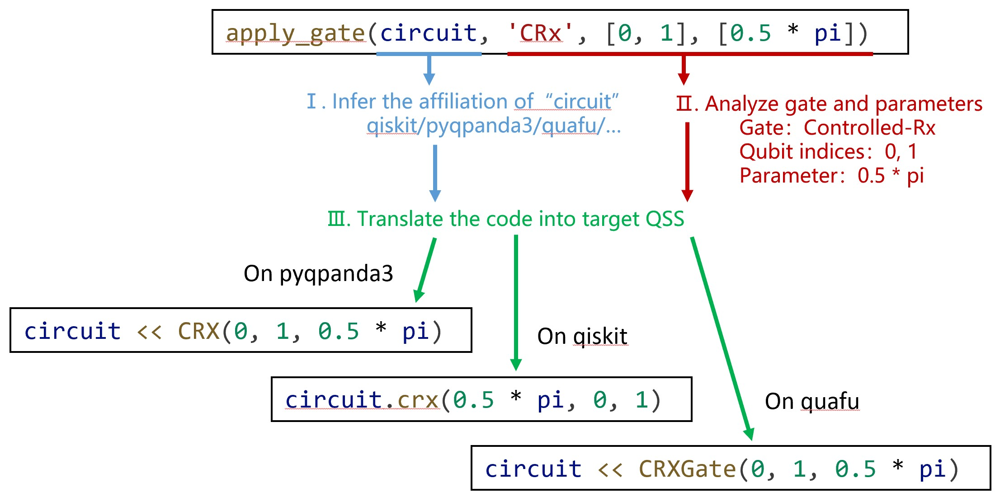

# Quantum Circuit Construction API
This page gives the APIs in PyQuantumKit for constructing quantum circuits, for users to consult. All functions covered on this page can be used simply by including the following at the beginning of a .py file:
```python
import pyquantumkit
```

## Basic Construction Functions
### apply_gate

The `apply_gate` function provides an interface for applying a quantum gate. The function prototype is:
```python
def apply_gate(q_circuit, gate_str : str, qbits : list[int], paras : list = None)
```

- The parameter `q_circuit` specifies the target quantum circuit. Its type is the quantum circuit class of a quantum development framework (for example qiskit's `QuantumCircuit`, pyqpanda3's `QCircuit` or `QProg`, quafu's `QuantumCircuit`, or cqlib's `Circuit`) or PyQuantumKit's `CircuitIO` class.
- The parameter `gate_str` is a string used to indicate the gate to be applied. Considering that the same gate may have multiple different names (for example Toffoli, CCNOT and CCX all denote the same gate), PyQuantumKit allows the same gate to be represented by different name strings, and is case-insensitive. [Click here](supported-gates.md) for the specific supported quantum gates and their corresponding strings.
- The parameter `qbits` is a list of integers, specifying the list of qubit indices on which the gate is to be applied. Note that regardless of whether the quantum gate is single-qubit or multi-qubit, this parameter must **be specified as a list**.
- The parameter `paras` is a list used to assign parameters to parameterized gates; for parameter-free gates, this parameter does not need to be assigned.

The apply_gate function translates the application of the quantum gate into the code of the corresponding quantum development framework, according to the quantum development framework to which the passed-in `q_circuit` parameter belongs. The differences in API names and implementation methods between different quantum development frameworks have already been taken into account in the code translation process. The figure below shows the flow of the code translation implemented by the apply_gate function:



In addition, if the target quantum development framework does not natively support a certain quantum gate, the function will translate it into a combination of supported quantum gates. For example, some quantum development frameworks do not support the $\sqrt{X}$ gate; the function will translate it into the sequential application of the $H$, $S$ and $H$ gates according to the identity $\sqrt{X}=HSH$.

### apply_measure
The `apply_measure` function implements measurement of the target qubits in a unified way. The function prototype is:

```python
def apply_measure(q_circuit, qindex : list[int], cindex : list[int])
```

- The parameter `q_circuit` specifies the target quantum circuit.
- The parameter `qindex` is a list of integers, specifying the indices of the qubits to be measured.
- The parameter `cindex` is a list of integers, specifying the indices of the classical bits where the measurement results are stored. The components of `qindex` and `cindex` correspond to each other respectively, so `qindex` and `cindex` should have the same length.

For example:
```python
apply_measure(qc, [2, 4, 6], [0, 1, 2])
```
measures the qubits with indices 2, 4 and 6 in `qc`, and stores the measurement results in the classical bits with indices 0, 1 and 2 respectively.

### multi_apply_sqgate
The `multi_apply_sqgate` function applies the same single-qubit quantum gate to each qubit in a set of qubits.

```python
def multi_apply_sqgate(q_circuit, gate_str : str, qbitlist : list[int], paras : list = None)
```

- The parameter `q_circuit` specifies the target quantum circuit.
- The parameter `gate_str` is a string used to indicate the gate to be applied.
- The parameter `qbitlist` is a list of integers. The function treats the list elements as indices and applies the quantum gate represented by `gate_str` to each corresponding qubit.
- The parameter `paras` is a list used to assign parameters to parameterized gates; for parameter-free gates, this parameter does not need to be assigned.

For example:
```python
multi_apply_sqgate(qc, 'H', range(7))
```
applies an H gate to each of the qubits with indices 0~6 in `qc` (7 in total).

### apply_reverse
The `apply_reverse` function applies a series of SWAP operations to reverse the order of qubits.

```python
def apply_reverse(q_circuit, qbitlist : list[int])
```

- The parameter `q_circuit` specifies the target quantum circuit.
- The parameter `qbitlist` is a list of integers, specifying the list of qubit indices on which the gate is to be applied.

Specifically, this function applies a SWAP gate to the first and last qubits corresponding to the index array `qbitlist`, applies a SWAP gate to the second and second-to-last, and so on.

## Modular Construction
[Click here](../../experimental/construct.md)
