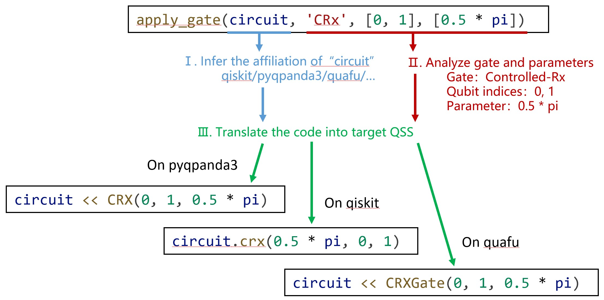

# Quantum Circuit Construction API
This page gives the API for constructing quantum circuits in PyQuantumKit, for users to consult. All functions involved on this page only need the following line at the beginning of the .py file:
```python
import pyquantumkit
```
to be used.

## Basic construction functions
### The apply_gate function

The `apply_gate` function provides an interface for applying a quantum gate, and its prototype is:
```python
def apply_gate(q_circuit, gate_str : str, qbits : list[int], paras : list = None)
```

- The parameter `q_circuit` specifies the target quantum circuit; its type is the quantum circuit class of each quantum development framework (for example qiskit's `QuantumCircuit`, pyqpanda3's `QCircuit` or `QProg`, quafu's `QuantumCircuit`, or cqlib's `Circuit`) or PyQuantumKit's `CircuitIO` class.
- The parameter `gate_str` is a string indicating the gate to be applied. Considering that the same gate may have multiple different names (for example Toffoli, CCNOT, and CCX all represent the same gate), PyQuantumKit allows different name strings to represent the same gate, and is case-insensitive. [Click here](supported-gates.md) for the specific supported quantum gates and their corresponding strings.
- The parameter `qbits` is an integer list specifying the list of qubit indices to which the gate is applied. Note that regardless of whether the quantum gate is single-bit or multi-bit, **this parameter needs to be assigned in the form of a list**.
- The parameter `paras` is a list used to assign parameters to parameterized gates; for parameterless gates, this parameter does not need to be assigned.

The apply_gate function translates the application of the quantum gate into the corresponding code of the quantum development framework, based on the quantum development framework to which the passed `q_circuit` parameter belongs. The code translation process has already taken into account the differences in API names and implementation methods among different quantum development frameworks. The following figure shows the workflow of the apply_gate function implementing code translation:



In addition, if the target quantum development framework does not natively support a certain quantum gate, the function translates it into a combination of supported gates. For example, some quantum development frameworks do not support the $\sqrt{X}$ gate, and the function translates it into the sequential application of $H$, $S$, $H$ gates according to the identity $\sqrt{X}=HSH$.

### The apply_measure function
The `apply_measure` function implements measuring the target qubits in a unified way, and its prototype is:

```python
def apply_measure(q_circuit, qindex : list[int], cindex : list[int])
```

- The parameter `q_circuit` specifies the target quantum circuit.
- The parameter `qindex` is an integer list specifying the indices of the qubits to be measured.
- The parameter `cindex` is an integer list specifying the indices of the classical bits where the measurement results are stored. The components of `qindex` and `cindex` correspond to each other respectively, so `qindex` and `cindex` should have the same length.

For example:
```python
apply_measure(qc, [2, 4, 6], [0, 1, 2])
```
measures the qubits with indices 2, 4, and 6 in `qc`, and stores the measurement results in the classical bits with indices 0, 1, and 2 respectively.

### The multi_apply_sqgate function
The `multi_apply_sqgate` function applies the same single-bit quantum gate to each qubit in a group of qubits.

```python
def multi_apply_sqgate(q_circuit, gate_str : str, qbitlist : list[int], paras : list = None)
```

- The parameter `q_circuit` specifies the target quantum circuit.
- The parameter `gate_str` is a string indicating the gate to be applied.
- The parameter `qbitlist` is an integer list; the function treats the list elements as indices and applies the quantum gate represented by `gate_str` to each corresponding qubit.
- The parameter `paras` is a list used to assign parameters to parameterized gates; for parameterless gates, this parameter does not need to be assigned.

For example:
```python
multi_apply_sqgate(qc, 'H', range(7))
```
applies an H gate to each of the qubits with indices 0 through 6 (7 in total) in `qc`.

### The apply_reverse function
The `apply_reverse` function applies a series of SWAP operations to reverse the order of the qubits.

```python
def apply_reverse(q_circuit, qbitlist : list[int])
```

- The parameter `q_circuit` specifies the target quantum circuit.
- The parameter `qbitlist` is an integer list specifying the list of qubit indices to which the gate is applied.

Specifically, this function applies a SWAP gate to the first and last qubits corresponding to the index array `qbitlist`, applies a SWAP gate to the second and second-to-last qubits, and so on.

## Usage of quantum subroutines (experimental)
### The apply_subroutine function
The `apply_subroutine` function provides an interface for applying a quantum subroutine, and its prototype is:
```python
def apply_subroutine(q_circuit, qsub_str : str, qbits : list[int], paras : list = None)
```

- The parameter `q_circuit` specifies the target quantum circuit; its type is the quantum circuit class of each quantum development framework (for example qiskit's `QuantumCircuit`, pyqpanda3's `QCircuit` or `QProg`, quafu's `QuantumCircuit`, or cqlib's `Circuit`) or PyQuantumKit's `CircuitIO` class.
- The parameter `qsub_str` is a string indicating the quantum subroutine to be applied, and is case-insensitive. [Click here](supported-subroutines.md) for the specific supported quantum gates and their corresponding strings.
- The parameter `qbits` is an integer list specifying the list of qubit indices to which the quantum subroutine is applied. Note that regardless of whether the quantum gate is single-bit or multi-bit, **this parameter needs to be assigned in the form of a list**.
- The parameter `paras` is a list used to assign parameters to the quantum subroutine (if the subroutine requires parameters).