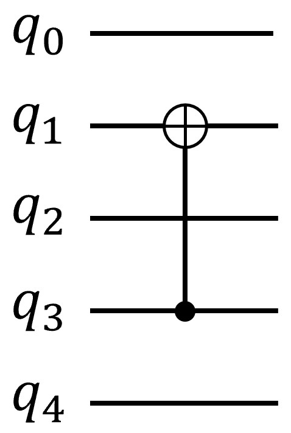
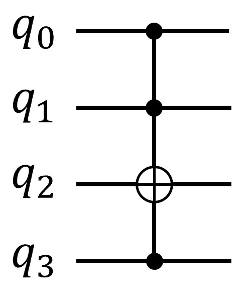

# The pyquantumkit.symbol module

## 1. The pyquantumkit.symbol.gate module
The `pyquantumkit.symbol.gate` module provides the matrix representation of basic gates (implemented based on the `sympy.Matrix` class).

### Quantum gate matrix objects
The module predefines the SymPy matrix objects corresponding to the supported quantum gates, or the functions that generate the matrix objects (for parameterized quantum gates). The specific object names can be used directly ([view details](./supported-gates.md)).

**Note: The matrices provided by this module follow the human-readable form, i.e., the form used in quantum computing textbooks, which may differ from conventions such as those in Qiskit.** For example, the matrix corresponding to a CNOT gate with the first qubit as the control bit and the second qubit as the controlled bit is:

$$ \begin{bmatrix} 1 & 0 & 0 & 0 \\ 0 & 1 & 0 & 0 \\ 0 & 0 & 0 & 1 \\ 0 & 0 & 1 & 0 \end{bmatrix} $$

The object corresponding to this matrix in the module is `pyquantumkit.symbol.gate.CNOT`.

### The symbol_gate_matrix function
The `symbol_gate_matrix` function can convert a string representing a quantum gate into a specific matrix object, and its prototype is:

```python
def symbol_gate_matrix(gate_str : str, paras : list = None) -> sympy.Matrix
```

- The parameter `gate_str` is a string indicating the quantum gate, the same as in the `apply_gate` function ([view details](./supported-gates.md)).
- The parameter `paras` is a list used to assign parameters to parameterized gates, the same as in the `apply_gate` function; for parameterless gates, this parameter does not need to be assigned.

For example: `symbol_gate_matrix('CNOT')` returns the sympy.Matrix object representing the CNOT gate.

### The symbol_inverse_gate function
The `symbol_inverse_gate` function takes a sympy.Matrix representing a quantum gate as input and returns its inverse matrix (i.e., the conjugate transpose), and its prototype is:

```python
def symbol_inverse_gate(mat : sympy.MatrixBase) -> sympy.Matrix
```

- The parameter `mat` is a sympy.Matrix object representing a unitary matrix. This function simply takes the conjugate transpose of `mat`, and does not check the unitarity of `mat`.

### The is_legal_gate_matrix function
The `is_legal_gate_matrix` function takes a sympy.Matrix representing a quantum gate as input and determines whether the matrix is a legal quantum gate matrix, and its prototype is:

```python
def is_legal_gate_matrix(mat : sympy.MatrixBase) -> bool
```

- The parameter `mat` is a sympy.Matrix object.

The function returns True if and only if `mat` is a square matrix and a unitary matrix.

### The reverse_matrix_endianness function
The matrices provided by this module follow the human-readable form, i.e., the form used in quantum computing textbooks. Some quantum development frameworks may use a convention of reversing the qubit order (for example Qiskit). `reverse_matrix_endianness` provides the conversion between these two representation forms, and its prototype is:

```python
def reverse_matrix_endianness(mat : sympy.MatrixBase) -> sympy.Matrix
```

- The parameter `mat` is a sympy.Matrix object.

The function returns the matrix obtained by reversing the endianness pattern of the `mat` matrix. For example, if the input is

$$ \begin{bmatrix} 1 & 0 & 0 & 0 \\ 0 & 1 & 0 & 0 \\ 0 & 0 & 0 & 1 \\ 0 & 0 & 1 & 0 \end{bmatrix} $$

then the function returns

$$ \begin{bmatrix} 1 & 0 & 0 & 0 \\ 0 & 0 & 0 & 1 \\ 0 & 0 & 1 & 0 \\ 0 & 1 & 0 & 0 \end{bmatrix} $$

## 2. The pyquantumkit.symbol.circuit module
The `pyquantumkit.symbol.circuit` module provides several functions for constructing the matrix representation of a quantum circuit from basic quantum gates.

### The symbol_apply_gate function

The `symbol_apply_gate` function applies a specified quantum gate on the qubits with the specified indices and returns the corresponding matrix representation. Its prototype is:

```python
def symbol_apply_gate(gate : sympy.Matrix, nqbits : int, indexlist : list[int]) -> sympy.Matrix:
```

- The parameter `gate` is a $2^k\times 2^k$ matrix, where $k$ represents the number of bits of the quantum gate. For example, a single-bit quantum gate ($k=1$) is a $2\times 2$ matrix, and a two-bit quantum gate ($k=2$) is a $4\times 4$ matrix.
- The parameter `nqbits` is a positive integer specifying the total number of qubits $n$; this parameter cannot be smaller than $k$.
- The parameter `indexlist` is a list specifying, in order, the indices of the bits on which the quantum gate acts. **Note that the indices start from 0, which is different from the Mathematica convention.** The length of the list must be $k$, i.e., matching the dimension of the `gate` parameter.
- The return value of this function is a $2^n\times 2^n$ matrix.

**Example 1**. Suppose there are 5 qubits in total, and a CNOT gate is applied with the qubit at index 3 as the control bit and the qubit at index 1 as the target bit, as shown in the following figure:

{ style="width: 20%; height: auto;" }

The function can be used as follows to generate the corresponding matrix representation:

```python
from pyquantumkit.symbol.gate import *
from pyquantumkit.symbol.circuit import *

Mat1 = symbol_apply_gate(CNOT, 5, [3, 1])
print(Mat1)
```

The return result is a $32\times 32$ (i.e., $2^5\times 2^5$) matrix.

```
Matrix([[1, 0, 0, 0, 0, 0, 0, 0, 0, 0, 0, 0, 0, 0, 0, 0, 0, 0, 0, 0, 0, 0, 0, 0, 0, 0, 0, 0, 0, 0, 0, 0],
        [0, 1, 0, 0, 0, 0, 0, 0, 0, 0, 0, 0, 0, 0, 0, 0, 0, 0, 0, 0, 0, 0, 0, 0, 0, 0, 0, 0, 0, 0, 0, 0],
        [0, 0, 0, 0, 0, 0, 0, 0, 0, 0, 1, 0, 0, 0, 0, 0, 0, 0, 0, 0, 0, 0, 0, 0, 0, 0, 0, 0, 0, 0, 0, 0],
        [0, 0, 0, 0, 0, 0, 0, 0, 0, 0, 0, 1, 0, 0, 0, 0, 0, 0, 0, 0, 0, 0, 0, 0, 0, 0, 0, 0, 0, 0, 0, 0],
        [0, 0, 0, 0, 1, 0, 0, 0, 0, 0, 0, 0, 0, 0, 0, 0, 0, 0, 0, 0, 0, 0, 0, 0, 0, 0, 0, 0, 0, 0, 0, 0],
        [0, 0, 0, 0, 0, 1, 0, 0, 0, 0, 0, 0, 0, 0, 0, 0, 0, 0, 0, 0, 0, 0, 0, 0, 0, 0, 0, 0, 0, 0, 0, 0],
        [0, 0, 0, 0, 0, 0, 0, 0, 0, 0, 0, 0, 0, 0, 1, 0, 0, 0, 0, 0, 0, 0, 0, 0, 0, 0, 0, 0, 0, 0, 0, 0],
        [0, 0, 0, 0, 0, 0, 0, 0, 0, 0, 0, 0, 0, 0, 0, 1, 0, 0, 0, 0, 0, 0, 0, 0, 0, 0, 0, 0, 0, 0, 0, 0],
        [0, 0, 0, 0, 0, 0, 0, 0, 1, 0, 0, 0, 0, 0, 0, 0, 0, 0, 0, 0, 0, 0, 0, 0, 0, 0, 0, 0, 0, 0, 0, 0],
        [0, 0, 0, 0, 0, 0, 0, 0, 0, 1, 0, 0, 0, 0, 0, 0, 0, 0, 0, 0, 0, 0, 0, 0, 0, 0, 0, 0, 0, 0, 0, 0],
        [0, 0, 1, 0, 0, 0, 0, 0, 0, 0, 0, 0, 0, 0, 0, 0, 0, 0, 0, 0, 0, 0, 0, 0, 0, 0, 0, 0, 0, 0, 0, 0],
        [0, 0, 0, 1, 0, 0, 0, 0, 0, 0, 0, 0, 0, 0, 0, 0, 0, 0, 0, 0, 0, 0, 0, 0, 0, 0, 0, 0, 0, 0, 0, 0],
        [0, 0, 0, 0, 0, 0, 0, 0, 0, 0, 0, 0, 1, 0, 0, 0, 0, 0, 0, 0, 0, 0, 0, 0, 0, 0, 0, 0, 0, 0, 0, 0],
        [0, 0, 0, 0, 0, 0, 0, 0, 0, 0, 0, 0, 0, 1, 0, 0, 0, 0, 0, 0, 0, 0, 0, 0, 0, 0, 0, 0, 0, 0, 0, 0],
        [0, 0, 0, 0, 0, 0, 1, 0, 0, 0, 0, 0, 0, 0, 0, 0, 0, 0, 0, 0, 0, 0, 0, 0, 0, 0, 0, 0, 0, 0, 0, 0],
        [0, 0, 0, 0, 0, 0, 0, 1, 0, 0, 0, 0, 0, 0, 0, 0, 0, 0, 0, 0, 0, 0, 0, 0, 0, 0, 0, 0, 0, 0, 0, 0],
        [0, 0, 0, 0, 0, 0, 0, 0, 0, 0, 0, 0, 0, 0, 0, 0, 1, 0, 0, 0, 0, 0, 0, 0, 0, 0, 0, 0, 0, 0, 0, 0],
        [0, 0, 0, 0, 0, 0, 0, 0, 0, 0, 0, 0, 0, 0, 0, 0, 0, 1, 0, 0, 0, 0, 0, 0, 0, 0, 0, 0, 0, 0, 0, 0],
        [0, 0, 0, 0, 0, 0, 0, 0, 0, 0, 0, 0, 0, 0, 0, 0, 0, 0, 0, 0, 0, 0, 0, 0, 0, 0, 1, 0, 0, 0, 0, 0],
        [0, 0, 0, 0, 0, 0, 0, 0, 0, 0, 0, 0, 0, 0, 0, 0, 0, 0, 0, 0, 0, 0, 0, 0, 0, 0, 0, 1, 0, 0, 0, 0],
        [0, 0, 0, 0, 0, 0, 0, 0, 0, 0, 0, 0, 0, 0, 0, 0, 0, 0, 0, 0, 1, 0, 0, 0, 0, 0, 0, 0, 0, 0, 0, 0],
        [0, 0, 0, 0, 0, 0, 0, 0, 0, 0, 0, 0, 0, 0, 0, 0, 0, 0, 0, 0, 0, 1, 0, 0, 0, 0, 0, 0, 0, 0, 0, 0],
        [0, 0, 0, 0, 0, 0, 0, 0, 0, 0, 0, 0, 0, 0, 0, 0, 0, 0, 0, 0, 0, 0, 0, 0, 0, 0, 0, 0, 0, 0, 1, 0],
        [0, 0, 0, 0, 0, 0, 0, 0, 0, 0, 0, 0, 0, 0, 0, 0, 0, 0, 0, 0, 0, 0, 0, 0, 0, 0, 0, 0, 0, 0, 0, 1],
        [0, 0, 0, 0, 0, 0, 0, 0, 0, 0, 0, 0, 0, 0, 0, 0, 0, 0, 0, 0, 0, 0, 0, 0, 1, 0, 0, 0, 0, 0, 0, 0],
        [0, 0, 0, 0, 0, 0, 0, 0, 0, 0, 0, 0, 0, 0, 0, 0, 0, 0, 0, 0, 0, 0, 0, 0, 0, 1, 0, 0, 0, 0, 0, 0],
        [0, 0, 0, 0, 0, 0, 0, 0, 0, 0, 0, 0, 0, 0, 0, 0, 0, 0, 1, 0, 0, 0, 0, 0, 0, 0, 0, 0, 0, 0, 0, 0],
        [0, 0, 0, 0, 0, 0, 0, 0, 0, 0, 0, 0, 0, 0, 0, 0, 0, 0, 0, 1, 0, 0, 0, 0, 0, 0, 0, 0, 0, 0, 0, 0],
        [0, 0, 0, 0, 0, 0, 0, 0, 0, 0, 0, 0, 0, 0, 0, 0, 0, 0, 0, 0, 0, 0, 0, 0, 0, 0, 0, 0, 1, 0, 0, 0],
        [0, 0, 0, 0, 0, 0, 0, 0, 0, 0, 0, 0, 0, 0, 0, 0, 0, 0, 0, 0, 0, 0, 0, 0, 0, 0, 0, 0, 0, 1, 0, 0],
        [0, 0, 0, 0, 0, 0, 0, 0, 0, 0, 0, 0, 0, 0, 0, 0, 0, 0, 0, 0, 0, 0, 1, 0, 0, 0, 0, 0, 0, 0, 0, 0],
        [0, 0, 0, 0, 0, 0, 0, 0, 0, 0, 0, 0, 0, 0, 0, 0, 0, 0, 0, 0, 0, 0, 0, 1, 0, 0, 0, 0, 0, 0, 0, 0]])
```

### The symbol_controlled_gate function

The `symbol_controlled_gate` function returns the matrix representation of the controlled form of a specified quantum gate. Its prototype is:

```python
def symbol_controlled_gate(gate : sympy.Matrix, nctrlbits : int) -> sympy.BlockDiagMatrix
```

- The parameter `gate` is a $2^k\times 2^k$ matrix, where $k$ represents the number of bits of the quantum gate.
- The parameter `nctrlbits` is a positive integer specifying the number of control qubits $n$.

The return value of this function is a $2^{n+k}\times 2^{n+k}$ block diagonal matrix (an object of the `sympy.BlockDiagMatrix` class), **where the corresponding first $n$ qubits are control bits and the last $k$ qubits are target bits.** Specifically, let $U$ be the matrix corresponding to the `gate` parameter, then this function returns a block diagonal matrix of the following form:

$$
CU = \begin{bmatrix} I_{2^k\times 2^k} & 0 & \cdots & 0 & 0 \\ 0 & I_{2^k\times 2^k} & \cdots & 0 & 0 \\ \vdots & \vdots & \ddots & \vdots & \vdots \\ 0 & 0 & \cdots & I_{2^k\times 2^k} & 0 \\ 0 & 0 & \cdots & 0 & U \end{bmatrix}_{2^{n+k}\times 2^{n+k}}
$$

where $I_{2^k\times 2^k}$ is the identity matrix, and there are $2^n-1$ such identity matrix blocks in total. Adding the last $U$ block, there are $2^n$ blocks in total.

Using the `symbol_controlled_gate` and `symbol_apply_gate` functions together, the matrix representation of a controlled gate with some qubits as control bits and other qubits as target bits can be generated.

**Example 2**. First generate an X gate controlled by 3 bits (i.e., the CCCNOT gate), which can be implemented as follows:
```python
cccnot = symbol_controlled_gate(X, 3)
```

Then construct a quantum circuit with the qubit at index 2 as the target bit and the rest as control bits using the above quantum gate, as shown in the following figure:

{ style="width: 20%; height: auto;" }

The implementation code is:
```python
Mat = symbol_apply_gate(cccnot, 4, [0, 1, 3, 2])
```

The array `[0, 1, 3, 2]` assigned here can be understood as follows: since the indices 0, 1, 2 of `cccnot` are controls and index 3 is the target, and we need qubit 2 to be the target bit, position 2 of the array (counting from 0) is assigned 3, while the remaining positions 0, 1, 3 are assigned 0, 1, 2 in order.

### The symbol_multi_apply_sqgate function

The `symbol_multi_apply_sqgate` function generates the matrix representation of applying a single-bit quantum gate on each qubit separately, i.e., given a $2\times 2$ matrix $U$ and the total number of qubits $n$, the function generates the matrix $U^{\otimes n}$. Its prototype is:

```python
def symbol_multi_apply_sqgate(sqgate : sympy.Matrix, nqbits : int) -> sympy.Matrix:
```

- The parameter `sqgate` is a $2\times 2$ matrix representing a single-bit quantum gate.
- The parameter `nqbits` is a positive integer representing the total number of qubits $n$.
- The function returns a $2^n\times 2^n$ matrix.

`symbol_multi_apply_sqgate(U, 2)` is equivalent to `sympy.KroneckerProduct(U, U)`;
`symbol_multi_apply_sqgate(U, 3)` is equivalent to `sympy.KroneckerProduct(U, U, U)`.

## 3. The pyquantumkit.symbol.qstate module
The `pyquantumkit.symbol.qstate` module provides SymPy matrix objects for the vector representation of basic quantum states, including ket representation (column vectors), bra representation (row vectors), and density matrix representation.

### Single-bit 0 state
- Ket representation: `Ket0`

$$\ket{0} = \begin{bmatrix} 1 \\ 0 \end{bmatrix}$$

- Bra representation: `Bra0`

$$\bra{0} = \begin{bmatrix} 1 & 0 \end{bmatrix}$$

- Density matrix: `Rho0`

$$\rho_0 = \ket{0}\bra{0} = \begin{bmatrix} 1 & 0 \\ 0 & 0 \end{bmatrix}$$

### Single-bit 1 state
- Ket representation: `Ket1`

$$\ket{1} = \begin{bmatrix} 0 \\ 1 \end{bmatrix}$$

- Bra representation: `Bra1`

$$\bra{1} = \begin{bmatrix} 0 & 1 \end{bmatrix}$$

- Density matrix: `Rho1`

$$\rho_1 = \ket{1}\bra{1} = \begin{bmatrix} 0 & 0 \\ 0 & 1 \end{bmatrix}$$

### Single-bit + state
- Ket representation: `KetPlus`

$$\ket{+} = \frac{1}{\sqrt 2}\left(\ket{0}+\ket{1}\right) = \begin{bmatrix} \frac{1}{\sqrt 2} \\ \frac{1}{\sqrt 2} \end{bmatrix}$$

- Bra representation: `BraPlus`

$$\bra{+} = \begin{bmatrix} \frac{1}{\sqrt 2} & \frac{1}{\sqrt 2} \end{bmatrix}$$

- Density matrix: `RhoPlus`

$$\rho_+ = \ket{+}\bra{+} = \begin{bmatrix} \frac{1}{2} & \frac{1}{2} \\ \frac{1}{2} & \frac{1}{2} \end{bmatrix}$$

### Single-bit - state
- Ket representation: `KetMinus`

$$\ket{-} = \frac{1}{\sqrt 2}\left(\ket{0}-\ket{1}\right) = \begin{bmatrix} \frac{1}{\sqrt 2} \\ -\frac{1}{\sqrt 2} \end{bmatrix}$$

- Bra representation: `BraMinus`

$$\bra{-} = \begin{bmatrix} \frac{1}{\sqrt 2} & -\frac{1}{\sqrt 2} \end{bmatrix}$$

- Density matrix: `RhoMinus`

$$\rho_- = \ket{-}\bra{-} = \begin{bmatrix} \frac{1}{2} & -\frac{1}{2} \\ -\frac{1}{2} & \frac{1}{2} \end{bmatrix}$$

### State on the Bloch sphere
- Ket representation: `KetBloch(theta_, phi_, gamma_)`

$$\ket{\psi} = e^{i\gamma}\left( \cos\frac{\theta}{2}\ket{0} + e^{i\phi}\sin\frac{\theta}{2}\ket{1} \right) = \begin{bmatrix} e^{i\gamma}\cos\frac{\theta}{2} \\ e^{i(\gamma+\phi)}\sin\frac{\theta}{2} \end{bmatrix}$$

- Bra representation: `BraBloch(theta_, phi_, gamma_)`

$$\bra{\psi} = e^{-i\gamma}\left( \cos\frac{\theta}{2}\bra{0} + e^{-i\phi}\sin\frac{\theta}{2}\bra{1} \right) = \begin{bmatrix} e^{-i\gamma}\cos\frac{\theta}{2} & e^{-i(\gamma+\phi)}\sin\frac{\theta}{2} \end{bmatrix}$$

- Density matrix: `RhoBloch(theta_, phi_, gamma_)`

$$\rho=\ket{\psi}\bra{\psi} = \begin{bmatrix} \cos^2(\frac{\theta}{2}) & e^{-i\phi}\cos\frac{\theta}{2}\sin\frac{\theta}{2} \\ e^{i\phi}\cos\frac{\theta}{2}\sin\frac{\theta}{2} & \sin^2(\frac{\theta}{2}) \end{bmatrix}$$

### Bell 00 state (the $\Phi^+$ state)
- Ket representation: `KetBell`

$$\ket{\beta_{00}} = \ket{\Phi^+} = \frac{1}{\sqrt 2}\left(\ket{00}+\ket{11}\right) = \begin{bmatrix} \frac{1}{\sqrt 2} \\ 0 \\ 0 \\ \frac{1}{\sqrt 2} \end{bmatrix}$$

- Bra representation: `BraBell`

$$\bra{\beta_{00}} = \frac{1}{\sqrt 2}\left(\bra{00}+\bra{11}\right) = \begin{bmatrix} \frac{1}{\sqrt 2} & 0 & 0 & \frac{1}{\sqrt 2} \end{bmatrix}$$

- Density matrix: `RhoBell`

$$\rho = \ket{\beta_{00}}\bra{\beta_{00}} = \begin{bmatrix} \frac{1}{2} & 0 & 0 & \frac{1}{2} \\ 0 & 0 & 0 & 0 \\ 0 & 0 & 0 & 0 \\ \frac{1}{2} & 0 & 0 & \frac{1}{2} \end{bmatrix}$$

### Bell 01 state (the $\Psi^+$ state)
- Ket representation: `KetBell01`

$$\ket{\beta_{01}} = \ket{\Psi^+} = \frac{1}{\sqrt 2}\left(\ket{01}+\ket{10}\right) = \begin{bmatrix} 0 \\ \frac{1}{\sqrt 2} \\ \frac{1}{\sqrt 2} \\ 0 \end{bmatrix}$$

- Bra representation: `BraBell01`

$$\bra{\beta_{01}} = \frac{1}{\sqrt 2}\left(\bra{01}+\bra{10}\right) = \begin{bmatrix} 0 & \frac{1}{\sqrt 2} & \frac{1}{\sqrt 2} & 0 \end{bmatrix}$$

- Density matrix: `RhoBell01`

$$\rho = \ket{\beta_{01}}\bra{\beta_{01}} = \begin{bmatrix} 0 & 0 & 0 & 0 \\ 0 & \frac{1}{2} & \frac{1}{2} & 0 \\ 0 & \frac{1}{2} & \frac{1}{2} & 0 \\ 0 & 0 & 0 & 0 \end{bmatrix}$$

### Bell 10 state (the $\Phi^-$ state)
- Ket representation: `KetBell10`

$$\ket{\beta_{10}} = \ket{\Phi^-} = \frac{1}{\sqrt 2}\left(\ket{00}-\ket{11}\right) = \begin{bmatrix} \frac{1}{\sqrt 2} \\ 0 \\ 0 \\ -\frac{1}{\sqrt 2} \end{bmatrix}$$

- Bra representation: `BraBell10`

$$\bra{\beta_{10}} = \frac{1}{\sqrt 2}\left(\bra{00}-\bra{11}\right) = \begin{bmatrix} \frac{1}{\sqrt 2} & 0 & 0 & -\frac{1}{\sqrt 2} \end{bmatrix}$$

- Density matrix: `RhoBell10`

$$\rho = \ket{\beta_{10}}\bra{\beta_{10}} = \begin{bmatrix} \frac{1}{2} & 0 & 0 & -\frac{1}{2} \\ 0 & 0 & 0 & 0 \\ 0 & 0 & 0 & 0 \\ -\frac{1}{2} & 0 & 0 & \frac{1}{2} \end{bmatrix}$$

### Bell 11 state (the $\Psi^-$ state)
- Ket representation: `KetBell11`

$$\ket{\beta_{11}} = \ket{\Psi^-} = \frac{1}{\sqrt 2}\left(\ket{01}-\ket{10}\right) = \begin{bmatrix} 0 \\ \frac{1}{\sqrt 2} \\ -\frac{1}{\sqrt 2} \\ 0 \end{bmatrix}$$

- Bra representation: `BraBell11`

$$\bra{\beta_{11}} = \frac{1}{\sqrt 2}\left(\bra{01}-\bra{10}\right) = \begin{bmatrix} 0 & \frac{1}{\sqrt 2} & -\frac{1}{\sqrt 2} & 0 \end{bmatrix}$$

- Density matrix: `RhoBell11`

$$\rho = \ket{\beta_{11}}\bra{\beta_{11}} = \begin{bmatrix} 0 & 0 & 0 & 0 \\ 0 & \frac{1}{2} & -\frac{1}{2} & 0 \\ 0 & -\frac{1}{2} & \frac{1}{2} & 0 \\ 0 & 0 & 0 & 0 \end{bmatrix}$$

### n-bit all-zero state
- Ket representation: `KetAllZero(nqbits)`, where the parameter `nqbits` specifies the number of qubits $n$

$$\ket{0\dots 0} = \begin{bmatrix} 1 \\ 0 \\ \vdots \\ 0 \end{bmatrix}_{2^n\times 1}$$

- Bra representation: `BraAllZero(nqbits)`, where the parameter `nqbits` specifies the number of qubits $n$

$$\bra{0\dots 0} = \begin{bmatrix} 1 & 0 & \cdots & 0 \end{bmatrix}_{1\times 2^n}$$

- Density matrix: `RhoAllZero(nqbits)`, where the parameter `nqbits` specifies the number of qubits $n$

$$\ket{0\dots 0}\bra{0\dots 0} = \begin{bmatrix} 1 & 0 & \cdots & 0 \\ 0 & 0 & \cdots & 0 \\ \vdots & \vdots & \ddots & \vdots \\ 0 & 0 & \cdots & 0 \end{bmatrix}_{2^n\times 2^n}$$

### n-bit uniform superposition state
- Ket representation: `KetUniformSuperposition(nqbits)`, where the parameter `nqbits` specifies the number of qubits $n$

$$\ket{\psi} = \frac{1}{\sqrt{2^n}}\sum_{x\in \{0,1\}^n}\ket{x} = \frac{1}{\sqrt{2^n}} \begin{bmatrix} 1 \\ 1 \\ \vdots \\ 1 \end{bmatrix}_{2^n\times 1}$$

- Bra representation: `BraUniformSuperposition(nqbits)`, where the parameter `nqbits` specifies the number of qubits $n$

$$\bra{\psi} = \frac{1}{\sqrt{2^n}}\sum_{x\in \{0,1\}^n}\bra{x} = \frac{1}{\sqrt{2^n}} \begin{bmatrix} 1 & 1 & \cdots & 1 \end{bmatrix}_{1\times 2^n}$$

- Density matrix: `RhoUniformSuperposition(nqbits)`, where the parameter `nqbits` specifies the number of qubits $n$

$$\rho = \ket{\psi}\bra{\psi} = \frac{1}{2^n} \begin{bmatrix} 1 & 1 & \cdots & 1 \\ 1 & 1 & \cdots & 1 \\ \vdots & \vdots & \ddots & \vdots \\ 1 & 1 & \cdots & 1 \end{bmatrix}_{2^n\times 2^n}$$