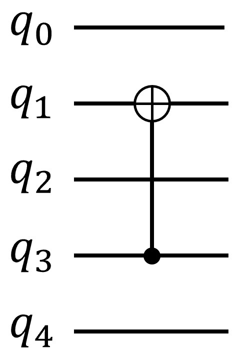
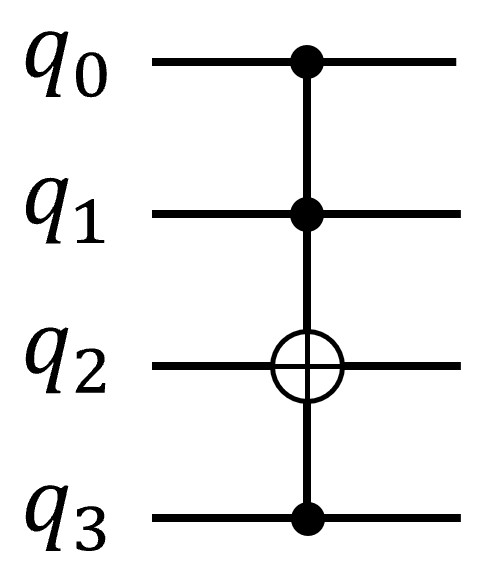

# pyquantumkit.symbol module

## I. pyquantumkit.symbol.gate module
The `pyquantumkit.symbol.gate` module provides the matrix representation of basic gates (implemented based on the `sympy.Matrix` class).

### Quantum gate matrix objects
The module predefines SymPy matrix objects corresponding to supported quantum gates, or functions that generate matrix objects (for parameterized quantum gates). You can directly reference them by the specific object name ([see details](./supported-gates.md)).

**Note: The matrices provided by this module follow the human-readable form, that is, the form used in quantum computing textbooks, which may differ from conventions such as those in Qiskit.** For example, the matrix corresponding to a CNOT gate with the first qubit as the control bit and the second qubit as the controlled bit is:

$$ \begin{bmatrix} 1 & 0 & 0 & 0 \\ 0 & 1 & 0 & 0 \\ 0 & 0 & 0 & 1 \\ 0 & 0 & 1 & 0 \end{bmatrix} $$

The object corresponding to this matrix in the module is `pyquantumkit.symbol.gate.CNOT`.

### symbol_gate_matrix function
The `symbol_gate_matrix` function can convert a string representing a quantum gate into a specific matrix object. The function prototype is:

```python
def symbol_gate_matrix(gate_str : str, paras : list = None) -> sympy.Matrix
```

- The parameter `gate_str` is a string indicating the quantum gate, the same as in the `apply_gate` function ([see details](./supported-gates.md)).
- The parameter `paras` is a list used to assign parameters to parameterized gates, the same as in the `apply_gate` function; for parameter-free gates, this parameter does not need to be assigned.

For example: `symbol_gate_matrix('CNOT')` will return the sympy.Matrix object representing the CNOT gate.

### symbol_inverse_gate function
The `symbol_inverse_gate` function takes a sympy.Matrix matrix representing a quantum gate and returns its inverse matrix (that is, the conjugate transpose). The function prototype is:

```python
def symbol_inverse_gate(mat : sympy.MatrixBase) -> sympy.Matrix
```

- The parameter `mat` is a sympy.Matrix object representing a unitary matrix. This function simply takes the conjugate transpose of `mat` and does not check the unitarity (unitariness) of `mat`.

### is_legal_gate_matrix function
The `is_legal_gate_matrix` function takes a sympy.Matrix matrix representing a quantum gate and determines whether the matrix is a legal quantum gate matrix. The function prototype is:

```python
def is_legal_gate_matrix(mat : sympy.MatrixBase) -> bool
```

- The parameter `mat` is a sympy.Matrix object.

The function returns True if and only if `mat` is a square matrix and is a unitary matrix.

### reverse_matrix_endianness function
The matrices provided by this module follow the human-readable form, that is, the form used in quantum computing textbooks. Some quantum development frameworks may use the convention of reversing the qubit order (for example Qiskit). `reverse_matrix_endianness` provides conversion between these two representation forms. The function prototype is:

```python
def reverse_matrix_endianness(mat : sympy.MatrixBase) -> sympy.Matrix
```

- The parameter `mat` is a sympy.Matrix object.

The function returns the matrix obtained by reversing the endianness mode of the `mat` matrix. For example, if the input is

$$ \begin{bmatrix} 1 & 0 & 0 & 0 \\ 0 & 1 & 0 & 0 \\ 0 & 0 & 0 & 1 \\ 0 & 0 & 1 & 0 \end{bmatrix} $$

then the function returns

$$ \begin{bmatrix} 1 & 0 & 0 & 0 \\ 0 & 0 & 0 & 1 \\ 0 & 0 & 1 & 0 \\ 0 & 1 & 0 & 0 \end{bmatrix} $$

## II. pyquantumkit.symbol.circuit module
The `pyquantumkit.symbol.circuit` module provides several functions for constructing the matrix representation of quantum circuits from basic quantum gates.

### symbol_apply_gate function

The `symbol_apply_gate` function applies the specified quantum gate on the qubits with the specified indices and returns the corresponding matrix representation. The function prototype is:

```python
def symbol_apply_gate(gate : sympy.Matrix, nqbits : int, indexlist : list[int]) -> sympy.Matrix:
```

- The parameter `gate` is a $2^k\times 2^k$ matrix, where $k$ represents the number of qubits of the quantum gate; for example, a single-qubit quantum gate ($k=1$) is a $2\times 2$ matrix and a two-qubit quantum gate ($k=2$) is a $4\times 4$ matrix.
- The parameter `nqbits` is a positive integer specifying the total number of qubits $n$; this parameter cannot be less than $k$.
- The parameter `indexlist` is a list specifying, in order, the indices of the qubits on which the quantum gate is to act. **Note that the indices start from 0, which differs from Mathematica's convention**. The length of the list must be $k$, that is, it must match the dimension of the parameter `gate`.
- The return value of this function is a $2^n\times 2^n$ dimensional matrix.

**Example 1**. Suppose there are 5 qubits in total. Apply a CNOT gate with the qubit with index 3 as the control bit and the qubit with index 1 as the target bit, as shown in the figure below:

{ style="width: 20%; height: auto;" }

The corresponding matrix representation can be generated by using this function as follows:

```python
from pyquantumkit.symbol.gate import *
from pyquantumkit.symbol.circuit import *

Mat1 = symbol_apply_gate(CNOT, 5, [3, 1])
print(Mat1)
```

The result returned is a $32\times 32$ (that is, $2^5\times 2^5$) dimensional matrix.

```
Matrix([[1, 0, 0, 0, 0, 0, 0, 0, 0, 0, 0, 0, 0, 0, 0, 0, 0, 0, 0, 0, 0, 0, 0, 0, 0, 0, 0, 0, 0, 0, 0, 0],
        [0, 1, 0, 0, 0, 0, 0, 0, 0, 0, 0, 0, 0, 0, 0, 0, 0, 0, 0, 0, 0, 0, 0, 0, 0, 0, 0, 0, 0, 0, 0, 0],
        [0, 0, 0, 0, 0, 0, 0, 0, 0, 0, 1, 0, 0, 0, 0, 0, 0, 0, 0, 0, 0, 0, 0, 0, 0, 0, 0, 0, 0, 0, 0, 0],
        [0, 0, 0, 0, 0, 0, 0, 0, 0, 0, 0, 1, 0, 0, 0, 0, 0, 0, 0, 0, 0, 0, 0, 0, 0, 0, 0, 0, 0, 0, 0, 0],
        [0, 0, 0, 0, 1, 0, 0, 0, 0, 0, 0, 0, 0, 0, 0, 0, 0, 0, 0, 0, 0, 0, 0, 0, 0, 0, 0, 0, 0, 0, 0, 0],
        [0, 0, 0, 0, 0, 1, 0, 0, 0, 0, 0, 0, 0, 0, 0, 0, 0, 0, 0, 0, 0, 0, 0, 0, 0, 0, 0, 0, 0, 0, 0, 0],
        [0, 0, 0, 0, 0, 0, 0, 0, 0, 0, 0, 0, 0, 0, 1, 0, 0, 0, 0, 0, 0, 0, 0, 0, 0, 0, 0, 0, 0, 0, 0, 0],
        [0, 0, 0, 0, 0, 0, 0, 0, 0, 0, 0, 0, 0, 0, 0, 1, 0, 0, 0, 0, 0, 0, 0, 0, 0, 0, 0, 0, 0, 0, 0, 0],
        [0, 0, 0, 0, 0, 0, 0, 0, 1, 0, 0, 0, 0, 0, 0, 0, 0, 0, 0, 0, 0, 0, 0, 0, 0, 0, 0, 0, 0, 0, 0, 0],
        [0, 0, 0, 0, 0, 0, 0, 0, 0, 1, 0, 0, 0, 0, 0, 0, 0, 0, 0, 0, 0, 0, 0, 0, 0, 0, 0, 0, 0, 0, 0, 0],
        [0, 0, 1, 0, 0, 0, 0, 0, 0, 0, 0, 0, 0, 0, 0, 0, 0, 0, 0, 0, 0, 0, 0, 0, 0, 0, 0, 0, 0, 0, 0, 0],
        [0, 0, 0, 1, 0, 0, 0, 0, 0, 0, 0, 0, 0, 0, 0, 0, 0, 0, 0, 0, 0, 0, 0, 0, 0, 0, 0, 0, 0, 0, 0, 0],
        [0, 0, 0, 0, 0, 0, 0, 0, 0, 0, 0, 0, 1, 0, 0, 0, 0, 0, 0, 0, 0, 0, 0, 0, 0, 0, 0, 0, 0, 0, 0, 0],
        [0, 0, 0, 0, 0, 0, 0, 0, 0, 0, 0, 0, 0, 1, 0, 0, 0, 0, 0, 0, 0, 0, 0, 0, 0, 0, 0, 0, 0, 0, 0, 0],
        [0, 0, 0, 0, 0, 0, 1, 0, 0, 0, 0, 0, 0, 0, 0, 0, 0, 0, 0, 0, 0, 0, 0, 0, 0, 0, 0, 0, 0, 0, 0, 0],
        [0, 0, 0, 0, 0, 0, 0, 1, 0, 0, 0, 0, 0, 0, 0, 0, 0, 0, 0, 0, 0, 0, 0, 0, 0, 0, 0, 0, 0, 0, 0, 0],
        [0, 0, 0, 0, 0, 0, 0, 0, 0, 0, 0, 0, 0, 0, 0, 0, 1, 0, 0, 0, 0, 0, 0, 0, 0, 0, 0, 0, 0, 0, 0, 0],
        [0, 0, 0, 0, 0, 0, 0, 0, 0, 0, 0, 0, 0, 0, 0, 0, 0, 1, 0, 0, 0, 0, 0, 0, 0, 0, 0, 0, 0, 0, 0, 0],
        [0, 0, 0, 0, 0, 0, 0, 0, 0, 0, 0, 0, 0, 0, 0, 0, 0, 0, 0, 0, 0, 0, 0, 0, 0, 0, 1, 0, 0, 0, 0, 0],
        [0, 0, 0, 0, 0, 0, 0, 0, 0, 0, 0, 0, 0, 0, 0, 0, 0, 0, 0, 0, 0, 0, 0, 0, 0, 0, 0, 1, 0, 0, 0, 0],
        [0, 0, 0, 0, 0, 0, 0, 0, 0, 0, 0, 0, 0, 0, 0, 0, 0, 0, 0, 0, 1, 0, 0, 0, 0, 0, 0, 0, 0, 0, 0, 0],
        [0, 0, 0, 0, 0, 0, 0, 0, 0, 0, 0, 0, 0, 0, 0, 0, 0, 0, 0, 0, 0, 1, 0, 0, 0, 0, 0, 0, 0, 0, 0, 0],
        [0, 0, 0, 0, 0, 0, 0, 0, 0, 0, 0, 0, 0, 0, 0, 0, 0, 0, 0, 0, 0, 0, 0, 0, 0, 0, 0, 0, 0, 0, 1, 0],
        [0, 0, 0, 0, 0, 0, 0, 0, 0, 0, 0, 0, 0, 0, 0, 0, 0, 0, 0, 0, 0, 0, 0, 0, 0, 0, 0, 0, 0, 0, 0, 1],
        [0, 0, 0, 0, 0, 0, 0, 0, 0, 0, 0, 0, 0, 0, 0, 0, 0, 0, 0, 0, 0, 0, 0, 0, 1, 0, 0, 0, 0, 0, 0, 0],
        [0, 0, 0, 0, 0, 0, 0, 0, 0, 0, 0, 0, 0, 0, 0, 0, 0, 0, 0, 0, 0, 0, 0, 0, 0, 1, 0, 0, 0, 0, 0, 0],
        [0, 0, 0, 0, 0, 0, 0, 0, 0, 0, 0, 0, 0, 0, 0, 0, 0, 0, 1, 0, 0, 0, 0, 0, 0, 0, 0, 0, 0, 0, 0, 0],
        [0, 0, 0, 0, 0, 0, 0, 0, 0, 0, 0, 0, 0, 0, 0, 0, 0, 0, 0, 1, 0, 0, 0, 0, 0, 0, 0, 0, 0, 0, 0, 0],
        [0, 0, 0, 0, 0, 0, 0, 0, 0, 0, 0, 0, 0, 0, 0, 0, 0, 0, 0, 0, 0, 0, 0, 0, 0, 0, 0, 0, 1, 0, 0, 0],
        [0, 0, 0, 0, 0, 0, 0, 0, 0, 0, 0, 0, 0, 0, 0, 0, 0, 0, 0, 0, 0, 0, 0, 0, 0, 0, 0, 0, 0, 1, 0, 0],
        [0, 0, 0, 0, 0, 0, 0, 0, 0, 0, 0, 0, 0, 0, 0, 0, 0, 0, 0, 0, 0, 0, 1, 0, 0, 0, 0, 0, 0, 0, 0, 0],
        [0, 0, 0, 0, 0, 0, 0, 0, 0, 0, 0, 0, 0, 0, 0, 0, 0, 0, 0, 0, 0, 0, 0, 1, 0, 0, 0, 0, 0, 0, 0, 0]])
```

### symbol_controlled_gate function

The `symbol_controlled_gate` function returns the matrix representation of the controlled form of the specified quantum gate. The function prototype is:

```python
def symbol_controlled_gate(gate : sympy.Matrix, nctrlbits : int) -> sympy.BlockDiagMatrix
```

- The parameter `gate` is a $2^k\times 2^k$ matrix, where $k$ represents the number of qubits of the quantum gate.
- The parameter `nctrlbits` is a positive integer specifying the number of control qubits $n$.

The return value of this function is a $2^{n+k}\times 2^{n+k}$ dimensional block diagonal matrix (a `sympy.BlockDiagMatrix` class object), **in which the corresponding first $n$ qubits are the control bits, and the last $k$ qubits are the target bits.** Specifically, let $U$ be the matrix corresponding to the `gate` parameter; then the function returns a block diagonal matrix of the following form:

$$
CU = \begin{bmatrix} I_{2^k\times 2^k} & 0 & \cdots & 0 & 0 \\ 0 & I_{2^k\times 2^k} & \cdots & 0 & 0 \\ \vdots & \vdots & \ddots & \vdots & \vdots \\ 0 & 0 & \cdots & I_{2^k\times 2^k} & 0 \\ 0 & 0 & \cdots & 0 & U \end{bmatrix}_{2^{n+k}\times 2^{n+k}}
$$

where $I_{2^k\times 2^k}$ is the identity matrix; there are a total of $2^n-1$ such identity matrix blocks. Adding the last $U$ block, there are $2^n$ blocks in total.

By using the `symbol_controlled_gate` and `symbol_apply_gate` functions together, you can generate the matrix representation of a controlled gate with some of the qubits as control bits and the others as target bits.

**Example 2**. First generate an X gate controlled by 3 bits (that is, a CCCNOT gate), which can be done as follows:
```python
cccnot = symbol_controlled_gate(X, 3)
```

Then construct a quantum circuit with the above quantum gate, using the qubit with index 2 as the target bit and the rest as control bits, as shown in the figure below:

{ style="width: 20%; height: auto;" }

The implementation code is:
```python
Mat = symbol_apply_gate(cccnot, 4, [0, 1, 3, 2])
```

The array `[0, 1, 3, 2]` assigned here can be understood as follows: since the indices 0, 1, 2 corresponding to `cccnot` are the controls and index 3 is the target, but we need qubit No. 2 as the target bit, position No. 2 of the array (counting from 0) is assigned 3, and the remaining positions No. 0, 1, 3 are assigned 0, 1, 2 in order.

### symbol_multi_apply_sqgate function

The `symbol_multi_apply_sqgate` function generates the matrix representation of applying a single-qubit quantum gate on each qubit separately, that is, given a $2\times 2$ matrix $U$ and the total number of qubits $n$, the function generates the matrix $U^{\otimes n}$. The function prototype is:

```python
def symbol_multi_apply_sqgate(sqgate : sympy.Matrix, nqbits : int) -> sympy.Matrix:
```

- The parameter `sqgate` is a $2\times 2$ matrix representing a single-qubit quantum gate.
- The parameter `nqbits` is a positive integer representing the total number of qubits $n$.
- The function returns a $2^n\times 2^n$ dimensional matrix.

`symbol_multi_apply_sqgate(U, 2)` is equivalent to `sympy.KroneckerProduct(U, U)`;
`symbol_multi_apply_sqgate(U, 3)` is equivalent to `sympy.KroneckerProduct(U, U, U)`.

## III. pyquantumkit.symbol.qstate module
The `pyquantumkit.symbol.qstate` module provides SymPy matrix objects representing basic quantum states, including ket representation (column vector), bra representation (row vector) and density matrix representation.

### Single-qubit 0 state
- Ket representation: `Ket0`

$$\ket{0} = \begin{bmatrix} 1 \\ 0 \end{bmatrix}$$

- Bra representation: `Bra0`

$$\bra{0} = \begin{bmatrix} 1 & 0 \end{bmatrix}$$

- Density matrix: `Rho0`

$$\rho_0 = \ket{0}\bra{0} = \begin{bmatrix} 1 & 0 \\ 0 & 0 \end{bmatrix}$$

### Single-qubit 1 state
- Ket representation: `Ket1`

$$\ket{1} = \begin{bmatrix} 0 \\ 1 \end{bmatrix}$$

- Bra representation: `Bra1`

$$\bra{1} = \begin{bmatrix} 0 & 1 \end{bmatrix}$$

- Density matrix: `Rho1`

$$\rho_1 = \ket{1}\bra{1} = \begin{bmatrix} 0 & 0 \\ 0 & 1 \end{bmatrix}$$

### Single-qubit + state
- Ket representation: `KetPlus`

$$\ket{+} = \frac{1}{\sqrt 2}\left(\ket{0}+\ket{1}\right) = \begin{bmatrix} \frac{1}{\sqrt 2} \\ \frac{1}{\sqrt 2} \end{bmatrix}$$

- Bra representation: `BraPlus`

$$\bra{+} = \begin{bmatrix} \frac{1}{\sqrt 2} & \frac{1}{\sqrt 2} \end{bmatrix}$$

- Density matrix: `RhoPlus`

$$\rho_+ = \ket{+}\bra{+} = \begin{bmatrix} \frac{1}{2} & \frac{1}{2} \\ \frac{1}{2} & \frac{1}{2} \end{bmatrix}$$

### Single-qubit - state
- Ket representation: `KetMinus`

$$\ket{-} = \frac{1}{\sqrt 2}\left(\ket{0}-\ket{1}\right) = \begin{bmatrix} \frac{1}{\sqrt 2} \\ -\frac{1}{\sqrt 2} \end{bmatrix}$$

- Bra representation: `BraMinus`

$$\bra{-} = \begin{bmatrix} \frac{1}{\sqrt 2} & -\frac{1}{\sqrt 2} \end{bmatrix}$$

- Density matrix: `RhoMinus`

$$\rho_- = \ket{-}\bra{-} = \begin{bmatrix} \frac{1}{2} & -\frac{1}{2} \\ -\frac{1}{2} & \frac{1}{2} \end{bmatrix}$$

### States on the Bloch sphere
- Ket representation: `KetBloch(theta_, phi_, gamma_)`

$$\ket{\psi} = e^{i\gamma}\left( \cos\frac{\theta}{2}\ket{0} + e^{i\phi}\sin\frac{\theta}{2}\ket{1} \right) = \begin{bmatrix} e^{i\gamma}\cos\frac{\theta}{2} \\ e^{i(\gamma+\phi)}\sin\frac{\theta}{2} \end{bmatrix}$$

- Bra representation: `BraBloch(theta_, phi_, gamma_)`

$$\bra{\psi} = e^{-i\gamma}\left( \cos\frac{\theta}{2}\bra{0} + e^{-i\phi}\sin\frac{\theta}{2}\bra{1} \right) = \begin{bmatrix} e^{-i\gamma}\cos\frac{\theta}{2} & e^{-i(\gamma+\phi)}\sin\frac{\theta}{2} \end{bmatrix}$$

- Density matrix: `BraBloch(theta_, phi_, gamma_)`

$$\rho=\ket{\psi}\bra{\psi} = \begin{bmatrix} \cos^2(\frac{\theta}{2}) & e^{-i\phi}\cos\frac{\theta}{2}\sin\frac{\theta}{2} \\ e^{i\phi}\cos\frac{\theta}{2}\sin\frac{\theta}{2} & \sin^2(\frac{\theta}{2}) \end{bmatrix}$$

### Bell 00 state ($\Phi^+$ state)
- Ket representation: `KetBell`

$$\ket{\beta_{00}} = \ket{\Phi^+} = \frac{1}{\sqrt 2}\left(\ket{00}+\ket{11}\right) = \begin{bmatrix} \frac{1}{\sqrt 2} \\ 0 \\ 0 \\ \frac{1}{\sqrt 2} \end{bmatrix}$$

- Bra representation: `BraBell`

$$\bra{\beta_{00}} = \frac{1}{\sqrt 2}\left(\bra{00}+\bra{11}\right) = \begin{bmatrix} \frac{1}{\sqrt 2} & 0 & 0 & \frac{1}{\sqrt 2} \end{bmatrix}$$

- Density matrix: `RhoBell`

$$\rho = \ket{\beta_{00}}\bra{\beta_{00}} = \begin{bmatrix} \frac{1}{2} & 0 & 0 & \frac{1}{2} \\ 0 & 0 & 0 & 0 \\ 0 & 0 & 0 & 0 \\ \frac{1}{2} & 0 & 0 & \frac{1}{2} \end{bmatrix}$$

### Bell 01 state ($\Psi^+$ state)
- Ket representation: `KetBell01`

$$\ket{\beta_{01}} = \ket{\Psi^+} = \frac{1}{\sqrt 2}\left(\ket{01}+\ket{10}\right) = \begin{bmatrix} 0 \\ \frac{1}{\sqrt 2} \\ \frac{1}{\sqrt 2} \\ 0 \end{bmatrix}$$

- Bra representation: `BraBell01`

$$\bra{\beta_{01}} = \frac{1}{\sqrt 2}\left(\bra{01}+\bra{10}\right) = \begin{bmatrix} 0 & \frac{1}{\sqrt 2} & \frac{1}{\sqrt 2} & 0 \end{bmatrix}$$

- Density matrix: `RhoBell01`

$$\rho = \ket{\beta_{01}}\bra{\beta_{01}} = \begin{bmatrix} 0 & 0 & 0 & 0 \\ 0 & \frac{1}{2} & \frac{1}{2} & 0 \\ 0 & \frac{1}{2} & \frac{1}{2} & 0 \\ 0 & 0 & 0 & 0 \end{bmatrix}$$

### Bell 10 state ($\Phi^-$ state)
- Ket representation: `KetBell10`

$$\ket{\beta_{10}} = \ket{\Phi^-} = \frac{1}{\sqrt 2}\left(\ket{00}-\ket{11}\right) = \begin{bmatrix} \frac{1}{\sqrt 2} \\ 0 \\ 0 \\ -\frac{1}{\sqrt 2} \end{bmatrix}$$

- Bra representation: `BraBell10`

$$\bra{\beta_{10}} = \frac{1}{\sqrt 2}\left(\bra{00}-\bra{11}\right) = \begin{bmatrix} \frac{1}{\sqrt 2} & 0 & 0 & -\frac{1}{\sqrt 2} \end{bmatrix}$$

- Density matrix: `RhoBell10`

$$\rho = \ket{\beta_{10}}\bra{\beta_{10}} = \begin{bmatrix} \frac{1}{2} & 0 & 0 & -\frac{1}{2} \\ 0 & 0 & 0 & 0 \\ 0 & 0 & 0 & 0 \\ -\frac{1}{2} & 0 & 0 & \frac{1}{2} \end{bmatrix}$$

### Bell 11 state ($\Psi^-$ state)
- Ket representation: `KetBell11`

$$\ket{\beta_{11}} = \ket{\Psi^+} = \frac{1}{\sqrt 2}\left(\ket{01}-\ket{10}\right) = \begin{bmatrix} 0 \\ \frac{1}{\sqrt 2} \\ -\frac{1}{\sqrt 2} \\ 0 \end{bmatrix}$$

- Bra representation: `BraBell11`

$$\bra{\beta_{11}} = \frac{1}{\sqrt 2}\left(\bra{01}-\bra{10}\right) = \begin{bmatrix} 0 & \frac{1}{\sqrt 2} & -\frac{1}{\sqrt 2} & 0 \end{bmatrix}$$

- Density matrix: `RhoBell11`

$$\rho = \ket{\beta_{11}}\bra{\beta_{11}} = \begin{bmatrix} 0 & 0 & 0 & 0 \\ 0 & \frac{1}{2} & -\frac{1}{2} & 0 \\ 0 & -\frac{1}{2} & \frac{1}{2} & 0 \\ 0 & 0 & 0 & 0 \end{bmatrix}$$

### n-qubit all-zero state
- Ket representation: `KetAllZero(nqbits)`, where the parameter `nqbits` specifies the number of qubits $n$

$$\ket{0\dots 0} = \begin{bmatrix} 1 \\ 0 \\ \vdots \\ 0 \end{bmatrix}_{2^n\times 1}$$

- Bra representation: `BraAllZero(nqbits)`, where the parameter `nqbits` specifies the number of qubits $n$

$$\bra{0\dots 0} = \begin{bmatrix} 1 & 0 & \cdots & 0 \end{bmatrix}_{1\times 2^n}$$

- Density matrix: `RhoAllZero(nqbits)`, where the parameter `nqbits` specifies the number of qubits $n$

$$\ket{0\dots 0}\bra{0\dots 0} = \begin{bmatrix} 1 & 0 & \cdots & 0 \\ 0 & 0 & \cdots & 0 \\ \vdots & \vdots & \ddots & \vdots \\ 0 & 0 & \cdots & 0 \end{bmatrix}_{2^n\times 2^n}$$

### n-qubit uniform superposition state
- Ket representation: `KetUniformSuperposition(nqbits)`, where the parameter `nqbits` specifies the number of qubits $n$

$$\ket{\psi} = \frac{1}{\sqrt{2^n}}\sum_{x\in \{0,1\}^n}\ket{x} = \frac{1}{\sqrt{2^n}} \begin{bmatrix} 1 \\ 1 \\ \vdots \\ 1 \end{bmatrix}_{2^n\times 1}$$

- Bra representation: `BraUniformSuperposition(nqbits)`, where the parameter `nqbits` specifies the number of qubits $n$

$$\bra{\psi} = \frac{1}{\sqrt{2^n}}\sum_{x\in \{0,1\}^n}\bra{x} = \frac{1}{\sqrt{2^n}} \begin{bmatrix} 1 & 1 & \cdots & 1 \end{bmatrix}_{1\times 2^n}$$

- Density matrix: `RhoUniformSuperposition(nqbits)`, where the parameter `nqbits` specifies the number of qubits $n$

$$\rho = \ket{\psi}\bra{\psi} = \frac{1}{2^n} \begin{bmatrix} 1 & 1 & \cdots & 1 \\ 1 & 1 & \cdots & 1 \\ \vdots & \vdots & \ddots & \vdots \\ 1 & 1 & \cdots & 1 \end{bmatrix}_{2^n\times 2^n}$$
