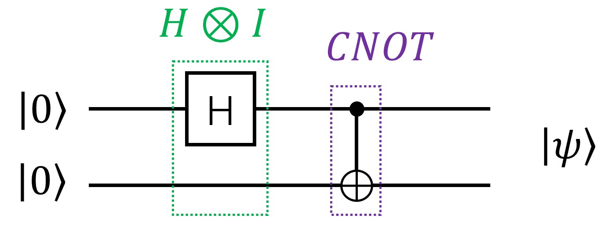

# Symbolic Representation of Quantum Circuit Matrices

PyQuantumKit provides the symbol module (`pyquantumkit.symbol`). This module is implemented based on the SymPy library and is used to construct the matrix representation of quantum circuits.

<!--*The hiquarc repository also contains another library QCirMat based on Mathematica for constructing the matrix representation of quantum circuits (see [https://github.com/hiquarc/QCirMat](https://github.com/hiquarc/QCirMat)). This symbol library can be regarded as a Python- and sympy-based version of QCirMat, making it convenient for users who do not have Mathematica.*-->

- The `pyquantumkit.symbol.gate` module provides the matrix representation of basic gates (based on the `sympy.Matrix` class).
- The `pyquantumkit.symbol.qstate` module provides the vector representation of basic quantum states (including ket representation, bra representation and density matrix representation).
- The `pyquantumkit.symbol.circuit` module provides several functions for constructing the matrix representation of quantum circuits.

**For detailed content of the pyquantumkit.symbol module, please [click here](./api/symbol.md).**

**Note: Since Python's convention for indices starts from 0, all parameters involving indices in the pyquantumkit.symbol library follow Python's convention of starting from 0, which differs from Mathematica's convention of starting from 1.**

## I. Using the Matrices Corresponding to Quantum Gates
The `pyquantumkit.symbol.gate` module predefines SymPy matrix objects corresponding to supported quantum gates, or functions that generate matrix objects (for parameterized quantum gates). You can directly reference them by the specific object name ([see details](./api/supported-gates.md)):

```python
import pyquantumkit.symbol.gate as PQK_S_GATE

print(PQK_S_GATE.Y)             # Y gate
print(PQK_S_GATE.SqrtXdag)      # √X gate
print(PQK_S_GATE.Rxx(0.5))      # Rxx gate with theta=0.5
```
The output is
```
Matrix([[0, -I], [I, 0]])
Matrix([[1/2 - I/2, 1/2 + I/2], [1/2 + I/2, 1/2 - I/2]])
Matrix([[0.968912421710645, 0, 0, -0.247403959254523*I],
        [0, 0.968912421710645, -0.247403959254523*I, 0],
        [0, -0.247403959254523*I, 0.968912421710645, 0],
        [-0.247403959254523*I, 0, 0, 0.968912421710645]])
```

You can also use the `symbol_gate_matrix` function, passing a string indicating the gate, which is the same as in the `apply_gate` function ([see details](./api/supported-gates.md)). The code in the above example can also be equivalently written as:

```python
import pyquantumkit.symbol.gate as PQK_S_GATE

print(PQK_S_GATE.symbol_gate_matrix('Y'))           # Y gate
print(PQK_S_GATE.symbol_gate_matrix('sxdg'))        # √X gate
print(PQK_S_GATE.symbol_gate_matrix('Rxx', [0.5]))  # Rxx gate with theta=0.5
```

## II. Using Quantum State Vectors
The `pyquantumkit.symbol.qstate` module predefines the state vector or matrix representation of common quantum states, such as the ket representation $\ket{0}$, the bra representation $\bra{+}$, the density matrix representation of the Bell state $\ket{\beta_{00}}\bra{\beta_{00}}$, etc. You can directly reference them by the specific object name ([see details](./api/symbol.md#pyquantumkitsymbolqstate)):

```python
import pyquantumkit.symbol.qstate as PQK_S_STATE

print(PQK_S_STATE.Ket0)
print(PQK_S_STATE.BraPlus)
print(PQK_S_STATE.RhoBell)
```

The output is
```
Matrix([[1], [0]])
Matrix([[sqrt(2)/2, sqrt(2)/2]])
Matrix([[1/2, 0, 0, 1/2], [0, 0, 0, 0], [0, 0, 0, 0], [1/2, 0, 0, 1/2]])
```

## III. Constructing the Matrix Corresponding to a Quantum Circuit
### Method 1: Directly Using SymPy Matrix Operations
One way to construct the matrix corresponding to a quantum circuit using the matrices of quantum gates is to directly use the matrix operations provided by SymPy: applying quantum gates sequentially corresponds to matrix multiplication, and applying quantum gates in parallel corresponds to the tensor product of matrices.

**Example 1**. Consider the following quantum circuit that prepares a Bell state:

{ style="width: 50%; height: auto;" }

It contains an H gate acting on the first qubit and a CNOT gate acting on the two qubits. The action of the H gate on the first qubit can be expressed in tensor product (Kronecker product) form as $H\otimes I$, and the total matrix representation is the product of the matrix representations of the two quantum gates:

$$CNOT \cdot (H\otimes I) = \begin{bmatrix} 1 & 0 & 0 & 0 \\ 0 & 1 & 0 & 0 \\ 0 & 0 & 0 & 1 \\ 0 & 0 & 1 & 0 \end{bmatrix} \cdot \left( \frac{1}{\sqrt 2}\begin{bmatrix} 1 & 1 \\ 1 & -1 \end{bmatrix} \otimes \begin{bmatrix} 1 & 0 \\ 0 & 1 \end{bmatrix} \right) = \frac{1}{\sqrt 2}\begin{bmatrix} 1 & 0 & 1 & 0 \\ 0 & 1 & 0 & 1 \\ 0 & 1 & 0 & -1 \\ 1 & 0 & -1 & 0 \end{bmatrix}$$

**Note: The order of matrix multiplication is the reverse of the order in which the quantum gates are applied!**

The following code, based on the quantum gate matrices predefined in `pyquantumkit.symbol.gate`, uses the matrix multiplication and Kronecker product provided by the SymPy library to compute the matrix representation of the above quantum circuit:
```python
import sympy
import pyquantumkit.symbol.gate as PQK_S_GATE

Circuit_Matrix =  PQK_S_GATE.CNOT * \
                  sympy.KroneckerProduct(PQK_S_GATE.H, PQK_S_GATE.Id)
print(Circuit_Matrix)
```
The running result is:
```
Matrix([[sqrt(2)/2, 0, sqrt(2)/2, 0],
        [0, sqrt(2)/2, 0, sqrt(2)/2],
        [0, sqrt(2)/2, 0, -sqrt(2)/2],
        [sqrt(2)/2, 0, -sqrt(2)/2, 0]])
```

### Method 2: Using the CircuitIO Class to Export the Matrix of a Quantum Circuit
A CircuitIO class object supports using SymPy symbols as the parameters of parameterized quantum gates (such as the Rx gate), and can compute the matrix representation of the entire quantum circuit based on the sequence of quantum gates already contained in the object. The functions for a CircuitIO class object to export the matrix representation of a quantum circuit are `get_sympy_matrix` (returns a SymPy matrix) and `get_numpy_matrix` (returns a NumPy matrix). For the specific details of the functions, please [click here](./api/circuitio.md#get_sympy_matrix).

**Example 1'**. Use the CircuitIO class to compute the matrix representation of the quantum circuit in Example 1

```python
import pyquantumkit

cio = pyquantumkit.CircuitIO(2)
cio.apply_gate('H', [0])
cio.apply_gate('CNOT', [0, 1])
Circuit_Matrix = cio.get_sympy_matrix()     # calculate the matrix of whole circuit
print(Circuit_Matrix)
```
The running result is the same as in Example 1:
```
Matrix([[sqrt(2)/2, 0, sqrt(2)/2, 0],
        [0, sqrt(2)/2, 0, sqrt(2)/2],
        [0, sqrt(2)/2, 0, -sqrt(2)/2],
        [sqrt(2)/2, 0, -sqrt(2)/2, 0]])
```
