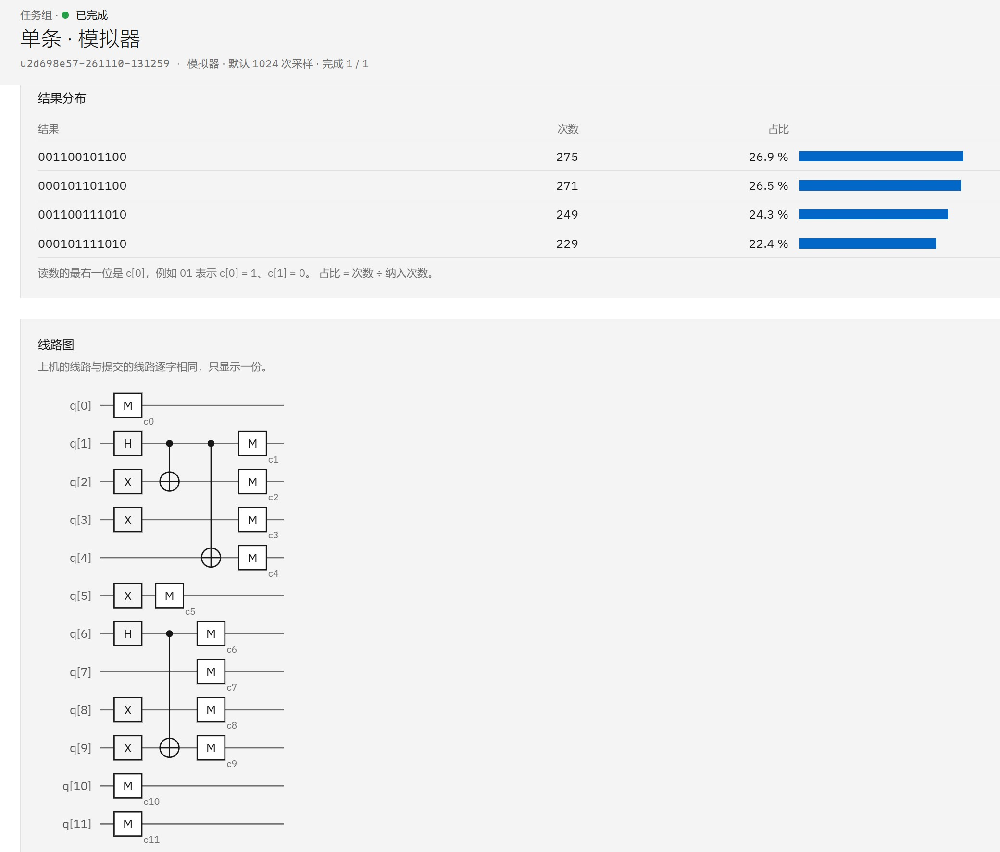

# Example: Running a High-Level-Language Quantum Program on the Quafu Platform
This example demonstrates how to use PyQuantumKit to run a high-level-language quantum program containing quantum data types on an actual quantum development platform.

Here we write a quantum program that prepares and measures the quantum state
$$
\frac{1}{\sqrt{2}}\left(\ket{a} + \ket{b}\right) \otimes \frac{1}{\sqrt{2}}\left(\ket{c} + \ket{d}\right)
$$
where $a,b,c,d$ are four pre-given integers whose length is adjustable. Submit the program to a simulator on the **new Quafu platform** provided by the Beijing Academy of Quantum Information Sciences ([https://quafu.com.cn/](https://quafu.com.cn/)) to run, and interpret the returned results.

## 1. Writing the high-level-language program
To express the above quantum state, we need to prepare two quantum integer variables `qnum1` and `qnum2`, and then prepare the quantum states $\frac{1}{\sqrt{2}}\left(\ket{a} + \ket{b}\right)$ and $\frac{1}{\sqrt{2}}\left(\ket{c} + \ket{d}\right)$ on them respectively. This can be done using the high-level-language quantum programming feature provided by PyQuantumKit, and the code is written as follows:

```python
import quafu
from pyquantumkit import QProgramBuilder
from pyquantumkit.program.std import *
from pyquantumkit.program.quint import *

# Input integers and their length
N = 6       # Each integer occupies 6 bits
a = 44
b = 58
c = 5
d = 12

# ---------- Main function ----------
def qmain(builder : QProgramBuilder):
    # Declare two quantum integer variables
    qnum1 = QuInt(N, 'qnum1')
    qnum2 = QuInt(N, 'qnum2')
    builder.declare_qvars(qnum1, qnum2)

    # Prepare two-value superposition states on the two quantum integer variables respectively
    qnum1.create_two_value_superposition(a, b)
    qnum2.create_two_value_superposition(c, d)

    # Measure
    builder.measure_all()
```

For convenience of demonstration, here we use global variables to directly provide the input.

## 2. Compile and export as OpenQASM 2.0 code
The new Quafu platform uses the OpenQASM 2.0 code format to submit quantum circuits, and PyQuantumKit supports exporting to OpenQASM 2.0 code. We first need to compile the high-level-language quantum program into a quantum circuit, and then export it as OpenQASM 2.0 code.

```python
# Compile the high-level-language quantum program into a quantum circuit
builder = QProgramBuilder()
builder.build(qmain)

# Convert the quantum circuit into OpenQASM 2.0 code
code = builder.get_built_circuit().export_standalone_code('OpenQASM2.0', 'qs')
print(code)     # Print the exported code
```

Here we call the `get_built_circuit()` method of the `QProgramBuilder` class object to obtain the compiled `CircuitIO` class object, and then call the `export_standalone_code()` method of the `CircuitIO` class object to export the OpenQASM 2.0 code corresponding to the quantum circuit.

Printing the exported code gives the following output:

```
// OpenQASM 2.0 code exported from PyQuantumKit
OPENQASM 2.0;
include "qelib1.inc";

qreg qs_q[12]; creg qs_c[12];
x qs_q[3];
x qs_q[5];
h qs_q[1];
x qs_q[2];
cx qs_q[1],qs_q[2];
cx qs_q[1],qs_q[4];
x qs_q[8];
h qs_q[6];
x qs_q[9];
cx qs_q[6],qs_q[9];
measure qs_q[0] -> qs_c[0]; 
measure qs_q[1] -> qs_c[1]; 
measure qs_q[2] -> qs_c[2]; 
measure qs_q[3] -> qs_c[3]; 
measure qs_q[4] -> qs_c[4]; 
measure qs_q[5] -> qs_c[5]; 
measure qs_q[6] -> qs_c[6]; 
measure qs_q[7] -> qs_c[7]; 
measure qs_q[8] -> qs_c[8]; 
measure qs_q[9] -> qs_c[9]; 
measure qs_q[10] -> qs_c[10]; 
measure qs_q[11] -> qs_c[11];
```

## 3. Submit the OpenQASM 2.0 code to the Quafu platform, run it, and obtain the raw results
For the specific code writing of this step, please refer to the user manual of the Quafu platform. Here we use the simulator provided by the cloud platform to run (setting the parameter `target="sim"`), with the number of repetitions (shots) set to 1024.

```python
job = quafu.submit(code, target="sim", shots=1024)
print("Job group ID:", job.id)

raw_counts = job.result().counts
print("Raw results:", raw_counts)
```

Command-line output:
```
Job group ID: u2d698e57-261110-131259
Raw results: {'001100101100': 275, '000101111010': 229, '000101101100': 271, '001100111010': 249}
```

You can also go to the Quafu website to view more detailed running information:


## 4. Interpret the raw results
For a high-level-language quantum program, the information of the quantum data types also needs to be recovered from the raw results. Call the `interpret_result_dict` method to interpret the quantum data type information from the raw result dictionary.

**Note: The measurement results of the new Quafu platform use the read-from-the-right convention (`'r'`), which is exactly opposite to the convention of the old PyQuafu.**

```python
# Interpret the raw measurement results
interpret_counts = builder.interpret_result_dict(raw_counts, 'r')
print("Interpreted results:", interpret_counts)
```

Output:

```
Interpreted results: [({'qnum1': 44, 'qnum2': 12}, 275),
({'qnum1': 58, 'qnum2': 5}, 229),
({'qnum1': 44, 'qnum2': 5}, 271),
({'qnum1': 58, 'qnum2': 12}, 249)]
```

The combinations of the measurement results are exactly the four combinations (44, 5), (58, 5), (44, 12), and (58, 12), which meets the expectation.