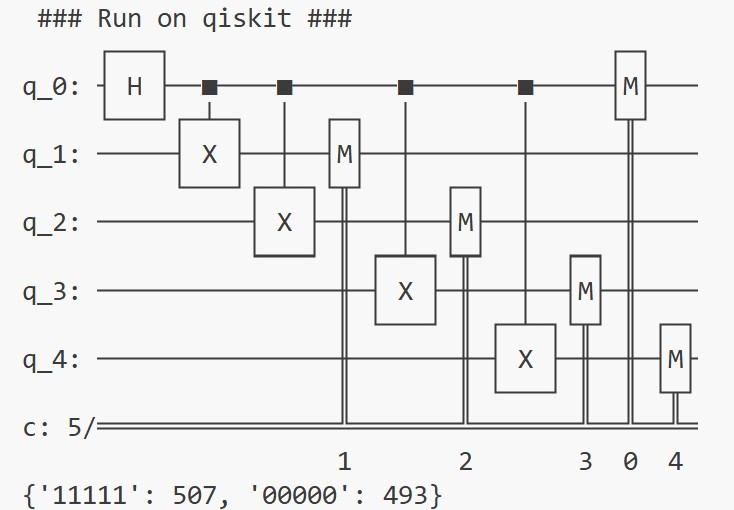
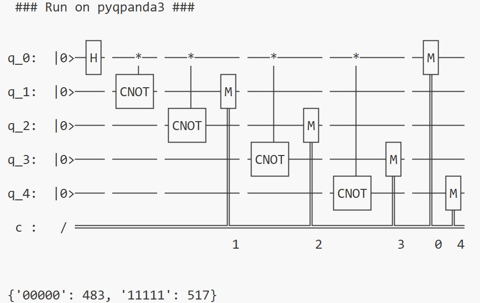
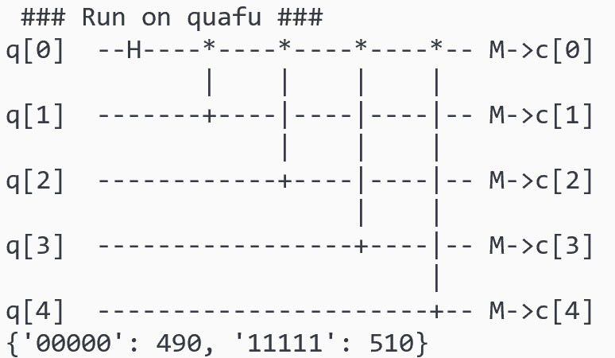

# Installation and Usage
## Installing PyQuantumKit

You can install PyQuantumKit with the `pip install` command:

```sh
pip install pyquantumkit
```

PyQuantumKit requires Python >= 3.8 and depends on the following Python packages:

- sympy >= 1.8
- numpy >= 1.22.0
- packaging >= 20.0

Usually, PyQuantumKit needs to be used together with a supported Python-based quantum development framework (such as qiskit or pyqpanda3). You can install PyQuantumKit and a supported quantum development framework at the same time; for example, use the following command to install qiskit together with PyQuantumKit:

```sh
pip install "pyquantumkit[qiskit]"
```

## GitHub

PyQuantumKit is open-source software under the MIT license. [Click here](https://github.com/hiquarc/PyQuantumKit) to visit the PyQuantumKit GitHub repository.

Use the `git clone` command to copy the PyQuantumKit repository to your local machine:

```sh
git clone https://github.com/hiquarc/PyQuantumKit.git
```

## Usage Example
Here we use a simple example to illustrate how to use PyQuantumKit to build quantum circuits in a unified way on different quantum development frameworks.

Requirement: construct a quantum circuit that generates a GHZ state, run it 1000 times and obtain the statistical measurement results. Write the code once, and use the three quantum development frameworks qiskit, pyqpanda3 and quafu respectively to build the quantum circuit, printing the constructed quantum circuit and the results of running on the simulator.

### 1. Import the required quantum development packages and PyQuantumKit

**Note:** In Python code, **`import pyquantumkit` must be placed after the imports of the specific quantum development packages**, to ensure that PyQuantumKit can recognize the imported quantum development package modules.

```python
# import quantum development kits.
import pyqpanda3.core as qpanda
import qiskit, qiskit_aer
import quafu

# import PyQuantumKit
# NOTE: the import of pyquantumkit must be put behind the quantum development kits.
import pyquantumkit as PQK
```

### 2. Write the circuit using functions provided by PyQuantumKit
Here two functions, `apply_gate` and `apply_measure`, are used. [Click here](circuit-level/circuit.md) to see the details of the functions.

```python
def ghz_state(circuit, nqbits : int):
    PQK.apply_gate(circuit, 'H', [0])               # Apply H gate on qubit with index 0
    for i in range(1, nqbits):
        PQK.apply_gate(circuit, 'cnot', [0, i])     # Apply CNOT gate on qubit with index 0 and i
    # Measure all qubits
    PQK.apply_measure(circuit, range(nqbits), range(nqbits))
```

### 3. Set the running parameters
Here 5 qubits are used and the number of running shots is 1000:

```python
# The number of qubits
Nqs = 5
# The number of running shots
Nshots = 1000
```

### 4. Run on qiskit

```python
print(' ### Run on qiskit ### ')

qiskit_circuit = qiskit.QuantumCircuit(Nqs, Nqs)
ghz_state(qiskit_circuit, Nqs)    # unified quantum circuit construction
print(qiskit_circuit)             # print quantum circuit

qiskit_qvm = qiskit_aer.Aer.get_backend('aer_simulator')
qiskit_job = qiskit_qvm.run(qiskit_circuit, shots = Nshots)
qiskit_result = qiskit_job.result().get_counts()
print(qiskit_result)        # print running results
```

The running result is:

{ style="width: 50%; height: auto;" }

### 5. Run on pyqpanda3

```python
print(' ### Run on pyqpanda3 ### ')

qpanda_circuit = qpanda.QProg(Nqs)
ghz_state(qpanda_circuit, Nqs)    # unified quantum circuit construction
print(qpanda_circuit)             # print quantum circuit

qpanda_qvm = qpanda.CPUQVM()
qpanda_qvm.run(qpanda_circuit, Nshots)
qpanda_result = qpanda_qvm.result().get_counts()
print(qpanda_result)        # print running results
```

The running result is:

{ style="width: 50%; height: auto;" }

### 6. Run on quafu

```python
print(' ### Run on quafu ### ')

quafu_circuit = quafu.QuantumCircuit(Nqs, Nqs)
ghz_state(quafu_circuit, Nqs)    # unified quantum circuit construction
quafu_circuit.draw_circuit()     # print quantum circuit

quafu_result = quafu.simulate(quafu_circuit, shots = Nshots)
print(quafu_result.counts)    # print running results
```

The running result is:

{ style="width: 50%; height: auto;" }
