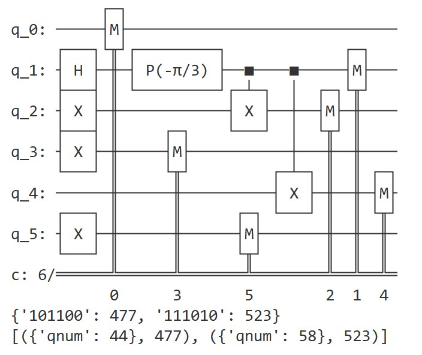
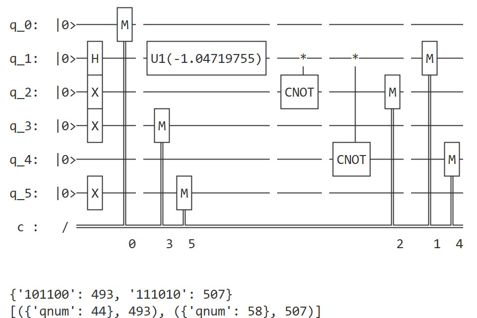
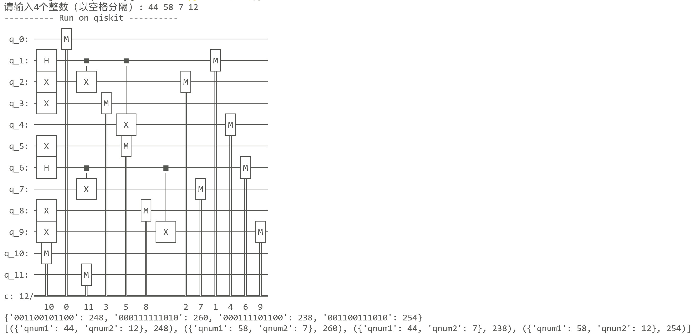
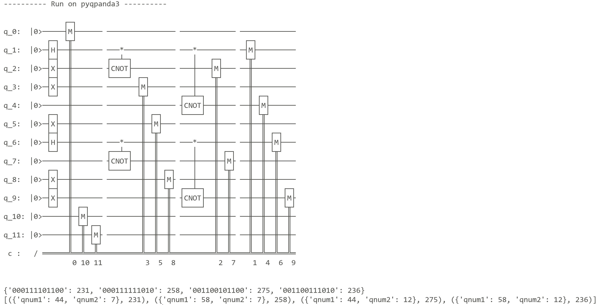

# PyQuantumKit High-Level Quantum Programming Demonstration Examples

Here we give two specific examples to show how to use PyQuantumKit for high-level-language-level quantum programming.

## Example 1. The program in the overview of this section

Here we use PyQuantumKit to write the program in [the overview of this section](introduction.md): preparing and measuring the binary superposition quantum state $\frac{1}{\sqrt{2}}\left(\ket{44} + e^{i\pi/3}\ket{58}\right)$ composed of the integers 44 and 58 and the relative phase angle $\pi/3$. Compile the program into Qiskit and QPanda3 quantum circuits respectively, run them on simulators, and interpret the output according to the data type.

### 1. First import the Qiskit and QPanda3 modules and the definition of pi in the math module:
```python
import pyqpanda3.core as qpanda
import qiskit
import qiskit_aer
from math import pi
```

### 2. Then import the required modules of PyQuantumKit
**Note:** As with quantum circuit-level programming, **`import pyquantumkit` must be placed after the imports of the specific quantum development packages**, to ensure that PyQuantumKit can recognize the imported quantum development package modules.
```python
from pyquantumkit import QProgramBuilder
from pyquantumkit.program.std import *
from pyquantumkit.program.quint import *
```

- The `QProgramBuilder` class is used to build a quantum program into a quantum circuit, and is responsible for interpreting the output results.
- The `pyquantumkit.program.std` module contains the necessary definitions for quantum program development.
- The `pyquantumkit.program.quint` module contains the type definitions of quantum integer variables.

### 3. Write the main function of the quantum program
```python
# The main function of the quantum program; the type of the first parameter must be QProgramBuilder
def qmain(builder : QProgramBuilder):
    # Declare quantum variables; here we declare a quantum integer variable qnum
    qnum = QuInt(6, 'qnum')
    # This line is required; calling declare_qvars() associates the local variable with the builder
    builder.declare_qvars(qnum)

    # Function body; here we call the member method of the quantum integer variable qnum to prepare a binary superposition state
    qnum.create_two_value_superposition(44, 58, pi / 3)

    # Measure the quantum variable qnum
    builder.measure(qnum)
```

**The first parameter of the main function of a quantum program must be a QProgramBuilder object**, and the function may also take other parameters. It is recommended to name the function `qmain` and write the first parameter as `builder : QProgramBuilder`.

The structure of the main function is divided into three major parts: **variable declaration, function body, measurement operation**, and **this order must be maintained**.

- In the variable declaration part, first define local variables within the function body; after the definitions are complete, call the `builder.declare_qvars(*args)` function (here `builder` is the first parameter of the main function) to associate the local variables with `builder`, so that they can undergo the subsequent qubit allocation and compilation into quantum circuits.
- In the function body part, write the specific operations on the declared quantum variables; only variables that have been declared (that is, listed in the parameters of `declare_qvars()`) can be operated on.
- In the measurement part, simply call the `builder.declare_qvars(*args)` function, where the parameters list, in order, the quantum variables to be measured.

In this example, we use the statement `qnum = QuInt(6, 'qnum')` to define a local variable `qnum` within the function, whose type is a quantum integer (`QuInt`) containing 6 qubits. The string `'qnum'` in the second parameter is the name of the variable, which is used when interpreting the measurement results. Then, we call `builder.declare_qvars(qnum)` to associate the local variable `qnum` with the builder.

The statement `qnum.create_two_value_superposition(44, 58, pi / 3)` calls the member method `create_two_value_superposition()` of the quantum integer variable `qnum` to prepare the required quantum state on this quantum integer variable with the given parameters.

### 4. Compile the program into a quantum circuit
```python
# Declare a QProgramBuilder class object
qpbuilder = QProgramBuilder()
# Call the build() member method of the QProgramBuilder object with the qmain function as the parameter
qpbuilder.build(qmain)
```
First declare a QProgramBuilder object, then call the member method `build()` with the `qmain` function as the parameter, and the quantum program `qmain` can be compiled into a quantum circuit. The compilation result is a `CircuitIO` object, which contains the generated quantum circuit (which can be understood as a kind of intermediate representation of a platform-independent quantum circuit); the member method `get_built_circuit()` can be used to obtain this `CircuitIO` object.

### 5. Run the quantum circuit on the Qiskit framework and interpret the results
```python
# ---------- Run on qiskit ----------
qiskit_cir = qiskit.QuantumCircuit(6, 6)

# Call qpbuilder.get_built_circuit() to obtain the compiled quantum circuit CircuitIO object
#    then use the >> operator to insert it into the Qiskit quantum circuit
qpbuilder.get_built_circuit() >> qiskit_cir
print(qiskit_cir)

# Run on the Qiskit simulator and obtain the result dictionary
qiskit_sim = qiskit_aer.AerSimulator()
result = qiskit_sim.run(qiskit_cir, shots = 1000).result().get_counts()
print(result)

# Call qpbuilder.interpret_result_dict() to interpret the information from the result dictionary
rec_result = qpbuilder.interpret_result_dict(result, 'r')
print(rec_result)
```
After the compilation is complete, call the member method `get_built_circuit()` of the QProgramBuilder object to obtain this `CircuitIO` object, then use the `>>` operator to insert it into the Qiskit quantum circuit. Run on the Qiskit simulator and obtain the result dictionary, then call `qpbuilder.interpret_result_dict()` to interpret the information from the result dictionary. The second parameter `'r'` therein is the interpretation convention for the measurement results; Qiskit adopts the convention of interpreting from the right, so this parameter is specified as `'r'`. The running result is:

{ style="width: 60%; height: auto;" }

As can be seen, the compiled and generated quantum circuit is the same as the hand-written Qiskit program in [the overview of this section](introduction.md).

The first line after the quantum circuit, `{'101100': 477, '111010': 523}`, is the raw Qiskit result dictionary, which represents the measurement results in the form of `'0'`/`'1'` strings.

The second line of output, `[({'qnum': 44}, 477), ({'qnum': 58}, 523)]`, is the information obtained by interpreting the raw result dictionary; it displays the measurement results of the quantum integer variable `qnum` in integer form.


### 6. Run the quantum circuit on the QPanda3 framework and interpret the results
```python
# ---------- Run on pyqpanda3 ----------
qpanda_cir = qpanda.QProg()

# Call qpbuilder.get_built_circuit() to obtain the compiled quantum circuit CircuitIO object
#    then use the >> operator to insert it into the QPanda3 quantum circuit
qpbuilder.get_built_circuit() >> qpanda_cir
print(qpanda_cir)

# Run on the QPanda3 simulator and obtain the result dictionary
qpanda_qvm = qpanda.CPUQVM()
qpanda_qvm.run(qpanda_cir, 1000)
qpanda_result = qpanda_qvm.result().get_counts()
print(qpanda_result)

# Call qpbuilder.interpret_result_dict() to interpret the information from the result dictionary
rec_result = qpbuilder.interpret_result_dict(qpanda_result, 'r')
print(rec_result)
```

The running result is:

{ style="width: 70%; height: auto;" }

## Example 2. Inputting integers from the command line and building a quantum state

Example 1 uses only one quantum variable. In fact, PyQuantumKit also supports defining multiple quantum variables. During the process of generating the quantum circuit, the required qubits can be automatically allocated to each quantum variable, and during the process of interpreting the measurement results, the classical bits of the measurement results corresponding to each quantum variable can also be automatically separated. In addition, PyQuantumKit also supports classical-quantum hybrid programming.

This example gives a slightly more complex example that contains both classical and quantum logic: input 4 integers $a, b, c, d$ between 0 and 63 from the command line, check whether the input meets the requirements, and if not, ask the user to re-enter until the requirements are met. Then, prepare and measure the quantum states $\frac{1}{\sqrt{2}}\left(\ket{a} + \ket{b}\right)$ and $\frac{1}{\sqrt{2}}\left(\ket{c} + \ket{d}\right)$ of two quantum integer variables respectively, where each quantum integer variable contains 6 qubits. Build the quantum circuits on the two frameworks Qiskit and QPanda3 respectively.

### 1. Import the quantum development frameworks and PyQuantumKit
```python
import pyqpanda3.core as qpanda
import qiskit
import qiskit_aer

from pyquantumkit import QProgramBuilder
from pyquantumkit.program.std import *
from pyquantumkit.program.quint import *
```

### 2. Write the logic for reading and checking the input
Here we write it as a function `input_numbers()`, which returns the corresponding list of integers if the validation passes, otherwise returns `None`.
```python
# Read integers from the command line and validate them
def input_numbers() -> list[int]:
    # Read the input from the command line (separated by spaces by default)
    raw_input = input("Please enter 4 integers (separated by spaces): ").split()
    
    # Validate the number of inputs
    if len(raw_input) != 4:
        print("Error: please enter exactly 4 integers.")
        return None
    try:
        # Convert to a list of integers (a ValueError is triggered if non-numeric characters are included)
        nums = [int(x) for x in raw_input]
        # Check one by one whether the range is within [0, 63]
        for i, val in enumerate(nums, start=1):
            if not (0 <= val <= 63):
                print(f"Error: the {i}-th integer {val} is not within the range 0 ~ 63.")
                return None
        # All constraints are satisfied; return the list
        return nums    
    except ValueError:
        print("Error: the input contains non-integer characters; please enter valid integers.")
        return None
```

### 3. Use PyQuantumKit to write the quantum program entry function qmain
```python
# The first parameter of the qmain function is a QProgramBuilder object, followed by 4 integer parameters
def qmain(builder : QProgramBuilder, a : int, b : int, c : int, d : int):
    # Define two quantum integer variables qnum1, qnum2
    qnum1 = QuInt(6, 'qnum1')
    qnum2 = QuInt(6, 'qnum2')
    builder.declare_qvars(qnum1, qnum2)

    qnum1.create_two_value_superposition(a, b)    # prepare the |a>+|b> state
    qnum2.create_two_value_superposition(c, d)    # prepare the |c>+|d> state

    # The measure_all() function measures all declared quantum variables in order
    builder.measure_all()
```
Besides the first parameter, which must be a `QProgramBuilder` object, the main function of a quantum program may also be followed by additional (classical) parameters, so as to implement passing classical data in from outside in classical-quantum hybrid programming.

### 4. Read the input, validate the input, and after validation passes, build the quantum program into a quantum circuit
```python
numbers = input_numbers()
while numbers is None:
    # Validation failed; ask the user to re-enter
    numbers = input_numbers()

# Validation passed; start building the quantum program
a, b, c, d = numbers
qpbuilder = QProgramBuilder()
# The first parameter of the build() function is qmain, and the following parameters pass in the 4 integers required by qmain in order
qpbuilder.build(qmain, a, b, c, d)
```

### 5. Running on Qiskit and QPanda3
```python
# ---------- Run on qiskit ----------
print("---------- Run on qiskit ----------")
qiskit_cir = qiskit.QuantumCircuit(12, 12)
qpbuilder.get_built_circuit() >> qiskit_cir
print(qiskit_cir)

qiskit_sim = qiskit_aer.AerSimulator()
result = qiskit_sim.run(qiskit_cir, shots = 1000).result().get_counts()
print(result)

rec_result = qpbuilder.interpret_result_dict(result, 'r')
print(rec_result)

# ---------- Run on pyqpanda3 ----------
print("---------- Run on pyqpanda3 ----------")
qpanda_cir = qpanda.QProg()
qpbuilder.get_built_circuit() >> qpanda_cir
print(qpanda_cir)

qpanda_qvm = qpanda.CPUQVM()
qpanda_qvm.run(qpanda_cir, 1000)
qpanda_result = qpanda_qvm.result().get_counts()
print(qpanda_result)

rec_result = qpbuilder.interpret_result_dict(qpanda_result, 'r')
print(rec_result)
```

### 6. Running results
First, check the running results under inputs that do not meet the requirements:

```
Please enter 4 integers (separated by spaces): 3 4 5↵
Error: please enter exactly 4 integers.
Please enter 4 integers (separated by spaces):
```

```
Please enter 4 integers (separated by spaces): 4 g 3 2↵
Error: the input contains non-integer characters; please enter valid integers.
Please enter 4 integers (separated by spaces):
```

```
Please enter 4 integers (separated by spaces): 23 45 63 99↵
Error: the 4-th integer 99 is not within the range 0 ~ 63.
Please enter 4 integers (separated by spaces):
```

Then we input a set of numbers that meet the requirements; here we input `44 58 7 12`. The running result is:

Compile the quantum program into a Qiskit quantum circuit, then run and interpret the results:


Compile the quantum program into a QPanda3 quantum circuit, then run and interpret the results:


Obviously, the entire quantum program requires 6+6=12 qubits, and the total quantum state is $\frac{1}{\sqrt{2}}\left(\ket{44} + \ket{58}\right) \otimes \frac{1}{\sqrt{2}}\left(\ket{7} + \ket{12}\right) = \frac{1}{2}(\ket{44}\ket{7} + \ket{58}\ket{7} + \ket{44}\ket{12} + \ket{58}\ket{12})$.

As can be seen, qubits No. 0~5 are allocated to the variable `qnum1`, and qubits No. 6~11 are allocated to the variable `qnum2`. The combinations of the measurement results are exactly the four kinds (44, 7), (58, 7), (44, 12), (58, 12), as expected.
