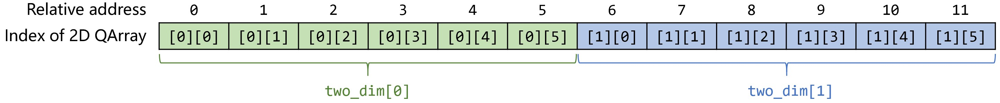
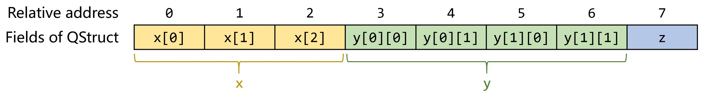
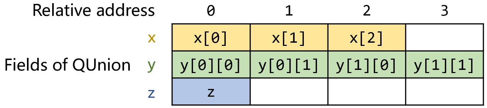

# Quantum Variable Memory Layout and Qubit Allocation
During the process of compiling a high-level-language quantum program into a quantum circuit, corresponding qubits need to be allocated to each quantum variable, and during the process of constructing a composite quantum data type, qubits need to be allocated to its elements or fields. This section introduces how quantum variables in quantum programs and various quantum data types are laid out and allocated qubits.

## 1. Memory layout of arrays, structs, and unions
In PyQuantumKit, the memory layout of arrays (QArray), structs (QStruct), and unions (QUnion) is similar to the memory layout of the corresponding arrays, structs, and unions in the C language.

The memory layout of an array is the continuous allocation of its elements. For example, the following two-dimensional array
```python
    twodim = make_qarray(QubitArray(6), 2, 'twodim')
```
has the following memory layout:



The memory layout of a struct is the **continuous allocation with no gaps** of its field variables; there are no gaps caused by byte alignment that may occur in C-language structs. The following struct
```python
class MyStruct(QStruct):
    def __init__(self, varname=None):
        super().__init__(varname)

        self.x = QubitArray(3, 'x')
        self.y = make_qarray(QubitArray(2), 2, 'y')
        self.z = Qubit('z')

        self.init_qstruct(self.x, self.y, self.z)
```
has the following memory layout:

{ style="width: 80%; height: auto;" }

The allocation order of the fields in a struct is based on the order of the parameters passed when calling the `init_qstruct()` function.

All fields of a union have the same starting address and share the same segment of quantum memory. The following union
```python
class MyUnion(QUnion):
    def __init__(self, varname=None):
        super().__init__(varname)

        self.x = QubitArray(3, 'x')
        self.y = make_qarray(QubitArray(2), 2, 'y')
        self.z = Qubit('z')

        self.init_qunion(self.x, self.y, self.z)
```
has the same field definitions as `MyStruct`, and its memory layout is:

{ style="width: 50%; height: auto;" }

### Obtaining the number of qubits of a quantum variable: the `n_qubits()` method
Every quantum variable occupies one or more qubits, and the `n_qubits()` method of the quantum variable can be called to obtain the number of qubits it occupies.
```python
def qmain(builder : QProgramBuilder):
    twodim = make_qarray(QubitArray(6), 2, 'twodim')
    mystruct = MyStruct('mystruct')
    myunion = MyUnion('myunion')
    
    print(twodim.n_qubits())       # -> 12
    print(mystruct.n_qubits())     # -> 8
    print(myunion.n_qubits())      # -> 4
```

The number of qubits occupied by various types of quantum variables is as follows:

- A `Qubit` type variable occupies 1 qubit;
- The number of qubits occupied by an array (QArray) type variable equals the array length multiplied by the number of qubits occupied by each element;
- The number of qubits occupied by a struct (QStruct) or tuple (QTuple) type variable equals the sum of the numbers of qubits occupied by its fields;
- The number of qubits occupied by a union (QUnion) type variable equals the number of qubits occupied by its longest field.

When calling the `n_qubits()` method on a variable of a composite quantum data type, the `n_qubits()` methods of its internal elements or fields are called recursively to complete the computation.

## 2. Allocation of qubits
Why is it necessary to call `declare_qvars(...)` when declaring quantum variables? And why is it necessary to call `init_qstruct(...)` and `init_qunion(...)` when initializing structs and unions? This is related to the process of qubit allocation, and this section gives a brief explanation.

During the process of compiling a quantum program into a quantum circuit, qubits in the final generated quantum circuit need to be allocated to each quantum variable. The `declare_qvars()` method of the `QProgramBuilder` class is used to complete this process. This method allocates qubits to each quantum variable in order from index 0, in the order of the passed quantum variables, and the number of qubits allocated to each quantum variable equals the number of qubits it needs to occupy (the return value of the `n_qubits()` method).
For example, in the following program
```python
def qmain(builder : QProgramBuilder):
    qarr2 = QubitArray(6, 'qarr2')
    qarr1 = QubitArray(6, 'qarr1')
    builder.declare_qvars(qarr1, qarr2)
    # ......
```
`qarr1` and `qarr2` each need to occupy 6 qubits. When calling `declare_qvars()`, the parameter order assigns `qarr1` first and then `qarr2`. Therefore, the 6 qubits with indices 0 through 5 are ultimately allocated to `qarr1` first, and then the 6 qubits with indices 6 through 11 are allocated to `qarr2`. Although `qarr2` is defined first inside the `qmain` function body, the final order of qubit allocation is based on the order of the parameters passed to `declare_qvars()`.

### Determining the address of a quantum variable
To complete the allocation of qubits, PyQuantumKit records two addresses for each quantum variable: the absolute address (denoted `_address`) and the relative address (denoted `_relative_address`).

The absolute address `_address` records the starting qubit index of the quantum variable in the final quantum circuit generated by compilation. Its default value is `None`, indicating that no qubit has been allocated to the quantum variable. When `declare_qvars()` is called, the `_address` of each quantum variable is modified to the corresponding index integer value. In fact, in addition to the `_address` of the quantum variables directly declared in the main function being determined, the `_address` values of the elements or fields inside each quantum variable are also determined. Determining the `_address` of the elements or fields inside a quantum variable requires the concept of the relative address.

The relative address `_relative_address` records the address offset value of the quantum variable relative to its outer quantum variable (for example, a struct field relative to the struct itself). When calling `init_qstruct()` and `init_qunion()`, the `_relative_address` of each field inside the struct or union is computed. Among them, the `_relative_address` of each field of a struct is allocated in order according to the order of the parameters passed to `init_qstruct()`, and the number of qubits allocated to each field equals the number of qubits it needs to occupy. For a union, when calling `init_qunion()`, the `_relative_address` of all fields is set to 0.

In fact, a similar process of computing relative addresses also exists when defining arrays and tuples, but this process is encapsulated in the `make_qarray()` and `make_qtuple()` functions.

When calling `declare_qvars()` in the main function to allocate qubits to a quantum variable, the `_address` values of its internal elements or fields are also determined, and the calculation formula is:

**Absolute address of an internal field/element of a variable := the absolute address of the variable itself + the relative address of the field/element**

Moreover, for composite data types, the process of computing `_address` calls recursively on its internal fields/elements. Therefore, no matter how many levels a composite data type is nested, the absolute addresses of the variables at all internal levels can be computed. After obtaining the absolute addresses of each quantum variable and its internal elements or fields (i.e., its starting qubit index in the quantum circuit), operations on quantum variables can be easily translated into operations on specific qubits in the quantum circuit.