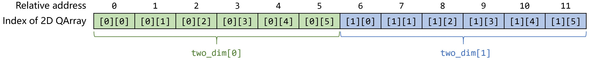
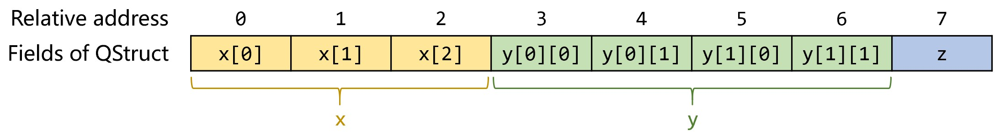
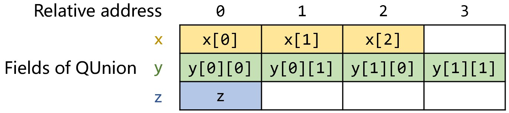

# Quantum Variable Memory Layout and Qubit Allocation
In the process of compiling a high-level-language-level quantum program into a quantum circuit, the corresponding qubits need to be allocated to each quantum variable, and in the process of constructing composite quantum data types, qubits need to be allocated to each of their elements or fields. This section introduces how quantum variables in quantum programs and in various kinds of quantum data types are laid out and allocated qubits.

## I. Memory Layout of Arrays, Structs and Unions
In PyQuantumKit, the memory layout of arrays (QArray), structs (QStruct) and unions (QUnion) is similar to the memory layout of the corresponding arrays, structs and unions in the C language.

The memory layout of an array is the contiguous allocation of its elements. For example, the following two-dimensional array
```python
    twodim = make_qarray(QubitArray(6), 2, 'twodim')
```
has its memory layout as shown in the figure:



The memory layout of a struct is the **contiguous allocation of its field variables with no gaps**; there is no gap left due to byte alignment that may occur for structs in the C language. The following struct
```python
class MyStruct(QStruct):
    def __init__(self, varname=None):
        super().__init__(varname)

        self.x = QubitArray(3, 'x')
        self.y = make_qarray(QubitArray(2), 2, 'y')
        self.z = Qubit('z')

        self.init_qstruct(self.x, self.y, self.z)
```
has its memory layout as shown in the figure:

{ style="width: 80%; height: auto;" }

The allocation order of the fields in a struct is based on the order of the parameters of the `init_qstruct()` function call.

All fields of a union have the same starting address and share the same segment of quantum memory. The following union
```python
class MyUnion(QUnion):
    def __init__(self, varname=None):
        super().__init__(varname)

        self.x = QubitArray(3, 'x')
        self.y = make_qarray(QubitArray(2), 2, 'y')
        self.z = Qubit('z')

        self.init_qunion(self.x, self.y, self.z)
```
has the same field definitions as `MyStruct`, and its memory layout is as shown in the figure:

{ style="width: 50%; height: auto;" }

### Obtaining the number of qubits of a quantum variable: the `n_qubits()` method
Each quantum variable needs to occupy one or more qubits, and you can call the `n_qubits()` method of a quantum variable to obtain the number of qubits it occupies.
```python
def qmain(builder : QProgramBuilder):
    twodim = make_qarray(QubitArray(6), 2, 'twodim')
    mystruct = MyStruct('mystruct')
    myunion = MyUnion('myunion')
    
    print(twodim.n_qubits())       # -> 12
    print(mystruct.n_qubits())     # -> 8
    print(myunion.n_qubits())      # -> 4
```

The number of qubits occupied by various types of quantum variables is as follows:

- A `Qubit` type variable occupies 1 qubit;
- The number of qubits occupied by an array (QArray) type variable is equal to the array length multiplied by the number of qubits occupied by each element;
- The number of qubits occupied by a struct (QStruct) or tuple (QTuple) type variable is equal to the sum of the numbers of qubits occupied by its fields;
- The number of qubits occupied by a union (QUnion) type variable is equal to the number of qubits occupied by its longest field.

When the `n_qubits()` method is called on a variable of a composite quantum data type, it recursively calls the `n_qubits()` methods of its internal elements or fields to complete the computation.

## II. Allocation of Qubits
Why is it necessary to call `declare_qvars(...)` when declaring a quantum variable? And why is it necessary to call `init_qstruct(...)` and `init_qunion(...)` when initializing a struct or union? This is related to the process of qubit allocation, and this section gives a brief explanation of it.

In the process of compiling a quantum program into a quantum circuit, the qubits in the finally generated quantum circuit need to be allocated to each quantum variable. The `declare_qvars()` method of the `QProgramBuilder` class is used to complete this process. This method allocates qubits to each quantum variable in turn starting from index 0, in the order of the passed-in quantum variables, and the number of qubits allocated to each quantum variable is equal to the number of qubits it needs to occupy (the return value of the `n_qubits()` method).
For example, in the following program
```python
def qmain(builder : QProgramBuilder):
    qarr2 = QubitArray(6, 'qarr2')
    qarr1 = QubitArray(6, 'qarr1')
    builder.declare_qvars(qarr1, qarr2)
    # ......
```
`qarr1` and `qarr2` each need to occupy 6 qubits. When calling `declare_qvars()`, the parameter order is `qarr1` first and then `qarr2`. Therefore, in the end, the 6 qubits with indices 0~5 are allocated to `qarr1` first, and then the 6 qubits with indices 6~11 are allocated to `qarr2`. Although `qarr2` is defined first within the `qmain` function body, the final allocation order of qubits is based on the order of the parameters of the `declare_qvars()` call.

### Determining the address of a quantum variable
In order to complete the allocation of qubits, PyQuantumKit records two addresses for each quantum variable: the absolute address (denoted as `_address`) and the relative address (denoted as `_relative_address`).

The absolute address `_address` records the starting qubit index corresponding to this quantum variable in the finally generated quantum circuit; its default value is `None`, indicating that this quantum variable has not been allocated a qubit. When `declare_qvars()` is called, the `_address` of each quantum variable is modified to the corresponding index integer value. In fact, besides the `_address` of the quantum variables directly declared in the main function being determined, the `_address` values of the elements or fields inside each quantum variable are also determined. Determining the `_address` of the elements or fields inside a quantum variable requires the concept of the relative address.

The relative address `_relative_address` records the address offset value of this quantum variable relative to its outer quantum variable (for example, a struct field relative to the struct itself). When `init_qstruct()` and `init_qunion()` are called, the `_relative_address` of each field in the struct or union is computed. Among them, the `_relative_address` of each field of a struct is allocated in turn according to the order of the parameters in the `init_qstruct()` call, and the number of qubits allocated to each field is equal to the number of qubits it needs to occupy. While for a union, when `init_qunion()` is called, the `_relative_address` of all fields is set to 0.

In fact, a similar process of computing relative addresses also exists when defining arrays and tuples, except that this process is encapsulated in the `make_qarray()` and `make_qtuple()` functions.

When `declare_qvars()` is called in the main function to allocate qubits to a quantum variable, the `_address` values of its internal elements or fields are also determined, with the computation formula:

**Absolute address of a field/element inside a variable := absolute address of the variable itself + relative address of the field/element**

Moreover, for composite data types, the process of computing `_address` recursively calls on its internal fields/elements. Therefore, no matter how many layers a composite data type is nested, the absolute addresses of the variables at each inner level can be computed. After obtaining the absolute addresses of each quantum variable and its internal elements or fields (that is, their starting qubit indices in the quantum circuit), operations on quantum variables can be easily translated into operations on specific qubits on the quantum circuit.
