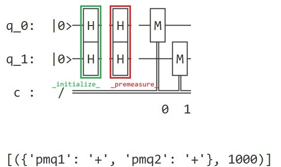
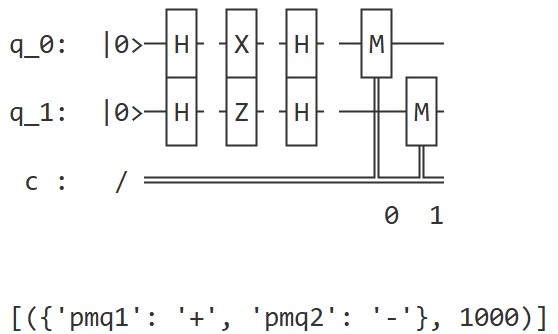
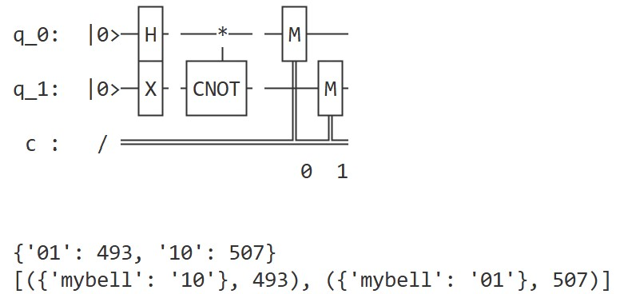
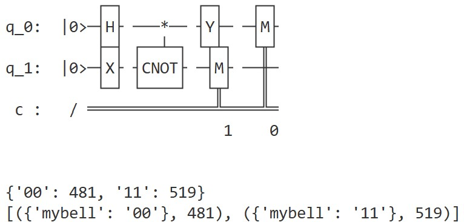

# Custom Quantum Data Types
The quantum type system of PyQuantumKit provides support for building quantum data types with complex structures.

In PyQuantumKit, the base type of all quantum data types is the abstract class `QVar`, so to build a custom quantum data type, a subclass must be derived directly or indirectly from the `QVar` class. In most cases, users usually do not need to derive directly from the `QVar` class, but rather from its subclasses (for example the qubit `Qubit`, the struct `QStruct`, the qubit array `QubitArray`, etc.).

A data type usually binds data together with the methods for operating on the data. Python classes provide a mechanism for defining functions belonging to objects of that class (called "methods"); using this mechanism, PyQuantumKit allows adding or overriding methods belonging to a custom quantum data type.

## I. Inheritance and Composition

In classical program design, there are two ways to define a custom data type: **inheritance** and **composition**. Based on Python's object-oriented type system, PyQuantumKit likewise supports these two ways of defining custom quantum data types.

### Defining a quantum data type by inheritance
The following example defines a `QuBool` type by inheriting the `Qubit` class. It inherits all the functionality of the `Qubit` type, and only changes the interpretation of the output result from producing `'0'`/`'1'` to producing `False`/`True`.
```python
class QuBool(Qubit):
    def _interpret_(self, output):
        return (True if super()._interpret_(output) == '1' else False)
```
Every quantum variable has a special method `_interpret_` (see below), which defines how this type interprets the result string. In the above example, the `QuBool` class overrides this method of its parent class `Qubit`: it first calls the parent class method, and returns `True` if the parent class method returns `1`; otherwise it returns `False`. The `_interpret_` method of the `Qubit` type already contains the logic for checking and reporting errors for illegal strings (non-`'0'`/`'1'` strings), so the `_interpret_` of the `QuBool` type does not need to additionally handle illegal strings.

Similar to classical program design, **inheritance expresses the "is-a" semantics**, so the specific semantics expressed by this example is: *the `QuBool` type is a special kind of the `Qubit` type.*

### Defining a quantum data type by composition
The `pyquantumkit.program.quint` module defines the unsigned quantum integer `QuUnsignedInt` (`QuInt` is actually an alias of this type). Its definition framework is roughly as follows:
```python
class QuUnsignedInt(QStruct):
    def __init__(self, length, varname = None):
        super().__init__(varname)
        self.__qubits = QubitArray(length)
        self.init_qstruct(self.__qubits)

    def _interpret(self, output : str):
        # ......
    def __len__(self):
        # ......
    def create_classical_value(self, number : int):
        # ......
    def create_two_value_superposition(self, x : int, y : int, phi : float = None):
        # ......
    
    # ......
```
That is, the `QuUnisgnedInt` type itself is a struct, and a private field `self.__qubits` of the qubit array type (`QubitArray`) is encapsulated in the struct. We wrote the method `_interpret_` for interpreting the result string, the magic method `__len__` for obtaining the length using the `len()` function, and also added the method `create_classical_value` for preparing a quantum state representing a classical integer and the method `create_two_value_superposition` for preparing a binary superposition state, etc.

The `QuUnisgnedInt` type is not built by directly inheriting the `QubitArray` type, but rather by encapsulating a field of the `QubitArray` type inside a struct. This is because if the inheritance approach were adopted, then `QuUnisgnedInt` would inherit all the methods of the `QubitArray` type, for example the `create_state_by_01pm_str` method that operates on each qubit. However, as a variable with the semantics of an "integer", we do not want users to call such low-level methods.

In most cases, custom quantum data types are built by composition. **Composition expresses the "has-a" semantics**, so the semantics expressed by this example is: *the quantum integer has a qubit array for storing information.* Based on this example, **we believe that the principle of "favor composition over inheritance" is still applicable to the construction of quantum data types.**

## II. Special Methods
The quantum data types of PyQuantumKit provide some special methods. These methods usually do not need to be called directly, but are automatically called when a specific operation is performed (for example initialization, measurement or interpreting the result string). Every quantum variable has default or explicitly defined special methods.

In PyQuantumKit, the convention is that special methods of quantum types are named with "a single leading underscore and a single trailing underscore". The special methods are introduced below.

### Initialization operation `_initialize_`
When the `declare_qvars()` operation is performed on a quantum variable, the initialization operation `_initialize_` of the quantum variable is automatically called, usually for preparing the initial quantum state for the quantum variable. The initialization operation is similar to a constructor in C++ or the `__init__` method of a Python class.

**Important note**: Since PyQuantumKit builds quantum data types based on Python syntax, **please be careful to distinguish `__init__` from `_initialize_` when using them; the former is the initialization as a Python class object, while the latter is the initialization of the quantum variable during the running of the quantum program.**

When defining the `_initialize_` method, it only needs one parameter `self`, and does not need a return value:
```python
    def _initialize_(self) -> None:
        # specific code
```

If not explicitly defined, the default initialization operation of the qubit `Qubit` is a no-op, and the default initialization operation of variables of array, struct and union types is to call the corresponding initialization operation on each of their elements or fields.

A union needs a separate explanation here: since the fields of a union share qubits, the order of initialization is especially important. PyQuantumKit calls the initialization functions of each field in turn according to the order of the parameters passed in when calling `init_qunion()`.

### Pre-measurement operation `_premeasure_`
When a measurement operation is performed on a quantum variable, PyQuantumKit automatically calls the pre-measurement operation `_premeasure_` of the quantum variable before applying the specific measurement gate. The pre-measurement operation is usually used to transform the measurement basis, in order to implement a more general measurement operation (non-computational-basis measurement).

When defining the `_premeasure_` method, it only needs one parameter `self`, and does not need a return value:
```python
    def _premeasure_(self) -> None:
        # specific code
```

If not explicitly defined, the default pre-measurement operation of the qubit `Qubit` is a no-op, the default pre-measurement operation of variables of array and struct types is to call the corresponding pre-measurement operation on each of their elements or fields, and variables of union type only call the pre-measurement operation on the active field.

### Result string interpretation method `_interpret_`
The `_interpret_` method defines how a quantum variable of this type should interpret the `'0'`/`'1'` string of the measurement result.

When defining the `_interpret_` method, it needs two parameters: `self` and `output: str` representing the measurement result string; and its return value is the interpretation result.
```python
    def _interpret_(self, output : str) -> Any:
        # specific code
        # finally the interpretation result needs to be returned
```

For quantum data types defined by inheritance or composition, the interpretation of their result string can often be obtained by appropriately processing the result interpretation method of the parent class or the contained fields. For example, in the previous example of the `QuBool` type, its `_interpret_` is obtained by appropriately processing the return result of calling `_interpret_` on its parent class `super()` (the `Qubit` type):
```python
class QuBool(Qubit):
    def _interpret_(self, output) -> bool:
        return (True if super()._interpret_(output) == '1' else False)
```

### Method for applying quantum gates to the data type, `_gate_`
The `_gate_` method defines how to apply quantum gates to the data type. Not all quantum variables have a `_gate_` method: the `Qubit` type has a `_gate_` method, but variables of array, struct and union types do not define a `_gate_` method by default. A quantum variable that defines a `_gate_` method can be used as a qubit, for example, the `gate()` function of the `pyquantumkit.program.std` module can be used on it to apply quantum gates.

When defining the `_gate_` method, it needs 4 parameters; the first parameter is `self`, and the next three parameters are the same as the parameters of the `gate()` function of the `pyquantumkit.program.std` module:
```python
    def _gate_(self, gate_name : str, qubit_var_list : list, paras : list) -> Qubit:
        # specific code
        # finally the qubit to be used as the target for applying the quantum gate needs to be returned
```
The return value of the function is the qubit that needs to be used as the target for applying the quantum gate. If it is a custom type built by inheriting the `Qubit` type, after writing the preceding processing logic, `self` can usually be returned directly.

The three parameters `gate_name`, `qubit_var_list` and `paras` can also be directly replaced by `*args`; this shorthand can be used when these three parameters do not need to be used in the method, but the parameters cannot be omitted.
```python
    def _gate_(self, *args) -> Qubit:
        # specific code
        # finally the qubit to be used as the target for applying the quantum gate needs to be returned
```


## III. Examples of Custom Quantum Data Types
A few examples are given below to illustrate how to use PyQuantumKit to define custom quantum data types.

#### **Example 1.** Define a qubit type `PMQubit` based on the $\ket{+},\ket{-}$ basis

Let's first look at what functionality the `PMQubit` type needs to implement. First, just as an ordinary qubit is usually initialized to the $\ket{0}$ state, a qubit based on the $\ket{+},\ket{-}$ basis also needs to take the state of one of the bases as its initial state. Here we assume that the state of a `PMQubit` type variable is initialized to $\ket{+}$ by default, which can be obtained by applying an H gate on the $\ket{0}$ state, so the initialization operation of this type should be an H gate.

Second, the measurement operation of the `PMQubit` type needs to be a measurement based on the $\ket{+},\ket{-}$ basis (rather than the usual computational-basis $\ket{0}, \ket{1}$ measurement), so the pre-measurement operation needs to be used to define the required basis transformation. Since the $\ket{+},\ket{-}$ basis and the $\ket{0}, \ket{1}$ basis can be related to each other through the H gate, the pre-measurement operation of this type is also an H gate.

Third, the measurement result of the `PMQubit` type should be represented as `'+'`/`'-'` rather than `'0'`/`'1'`, which requires overriding the result string interpretation method. Since $\ket{+}$ and $\ket{0}$, and $\ket{-}$ and $\ket{1}$, are respectively related to each other through the pre-measurement H gate, the raw measurement result `'0'` corresponds to the final measurement result `'+'`, and `'1'` corresponds to `'-'`.

Finally, from a logical point of view, `PMQubit` is a special kind of `Qubit`, which is the is-a semantics, so it is suitable to define it by inheritance.

The definition and implementation code is as follows:
```python
# A qubit type based on the |+>, |-> basis, defined by inheriting the Qubit class
class PMQubit(Qubit):
    # initialization operation
    def _initialize_(self) -> None:
        gate('H', [self])

    # pre-measurement operation
    def _premeasure_(self) -> None:
        gate('H', [self])

    # interpret the measurement result
    def _interpret_(self, output : str) -> str:
        return ('+' if super()._interpret_(output) == '0' else '-')
```

In the above code, the `PMQubit` type inherits the `Qubit` type, but overrides the `_initialize_`, `_premeasure_` and `_interpret_` methods. Since the `PMQubit` type is itself a `Qubit`, in the initialization operation and the pre-measurement operation, applying the H gate can directly use `self` as the target qubit.

Let's write a few programs to verify the behavior of the `PMQubit` type.

The following program
```python
# verify the initialization and pre-measurement operations of PMQubit
def qmain(builder : QProgramBuilder):
    pmq1 = PMQubit('pmq1')
    pmq2 = PMQubit('pmq2')
    builder.declare_qvars(pmq1, pmq2)
    builder.measure_all()
```
declares two `PMQubit` variables and then directly measures them. The compiled and generated quantum circuit and the running result are:

{ style="width: 60%; height: auto;" }

According to the definition, each `PMQubit` type quantum variable applies an H gate when declared, and also applies an H gate before measurement, so the compiled and generated quantum circuit contains 4 H gates in total (no optimization is done in this example). The measurement result is interpreted as
```
[({'pmq1': '+', 'pmq2': '+'}, 1000)]
```
That is, from a logical point of view, the default initial state of a variable of the `PMQubit` type is $\ket{+}$, which meets the requirement.

The following program
```python
# operations on a PMQubit type variable
def qmain(builder : QProgramBuilder):
    pmq1 = PMQubit('pmq1')
    pmq2 = PMQubit('pmq2')
    builder.declare_qvars(pmq1, pmq2)

    gate('X', [pmq1])
    gate('Z', [pmq2])

    builder.measure_all()
```
based on the previous program, applies an X gate on `pmq1` and a Z gate on `pmq2`, then measures. The compiled and generated quantum circuit and the running result are:

{ style="width: 60%; height: auto;" }

As can be seen, the generated quantum circuit inserts an X gate and a Z gate respectively between the pair of H gates for initialization and before measurement. The measurement result is interpreted as:
```
[({'pmq1': '+', 'pmq2': '-'}, 1000)]
```
The measurement result of `pmq1` after applying the X gate is still `+`, while the measurement result of `pmq2` after applying the Z gate becomes `-`, equivalent to a "bit flip". This is exactly the opposite of the situation in the $\ket{0},\ket{1}$ basis, where the X gate flips the qubit and the Z gate only produces a phase transformation. In fact, according to the identities $X=HZH$ and $Z=HXH$, in the $\ket{+},\ket{-}$ basis, the roles of the Z gate and the X gate are exactly interchanged.

#### **Example 2.** Define a qubit type `CliffordQubit` that only allows Clifford gates

First, `CliffordQubit` is also a special kind of `Qubit`; this is still the is-a semantics, so it is defined by inheriting the `Qubit` type.

Then the `CliffordQubit` type needs to check the kind of quantum gate when applying a quantum gate, so the `_gate_` method needs to be overridden to add the step of checking the kind of quantum gate.

The definition and implementation code is as follows:
```python
# a qubit that only allows Clifford gates
class CliffordQubit(Qubit):
    def _gate_(self, gate_name : str, qubit_var_list : list, paras : list) -> Qubit:
        # call the get_standard_gatename() function to convert gate_name to the PyQuantumKit standard name
        standard_name = get_standard_gatename(gate_name)

        # report an error if the gate used is not a Clifford gate
        if standard_name not in {'I', 'X', 'Y', 'Z', 'S', 'H', 'CX', 'CY', 'CZ', 'SW', 'ISW'}:
            raise QuantumProgramBuildError(f"Cannot apply non-Clifford gate '{gate_name}' on the CliffordQubit '{self.get_varname()}'")
        
        # if the gate used is a Clifford gate, return self as the target for calling gate()
        return self
```
In the above code, the `CliffordQubit` type inherits the `Qubit` type, but overrides the `_gate_` method. Before returning `self` as the target qubit for applying the quantum gate, it first calls the `get_standard_gatename()` function (provided by PyQuantumKit) to convert the name of the quantum gate into the standard name, and then checks whether it is a Clifford gate according to the standard name. If not, it reports an error.

The above examples define special qubit types by overriding the special methods of the `Qubit` type. The following gives an example of defining a quantum data type by composition.

#### **Example 3.** Define a data type that stores a Bell state, and provide conversion operations between the four Bell states

The definitions of the four Bell states are:

$$
\begin{aligned}
\ket{\Phi^+} &= \frac{\ket{00} + \ket{11}}{\sqrt{2}} \\
\ket{\Phi^-} &= \frac{\ket{00} - \ket{11}}{\sqrt{2}} \\
\ket{\Psi^+} &= \frac{\ket{01} + \ket{10}}{\sqrt{2}} \\
\ket{\Psi^-} &= \frac{\ket{01} - \ket{10}}{\sqrt{2}}
\end{aligned}
$$

These four Bell states can be converted into each other by applying a Pauli gate ($I$, $X$, $Y$, $Z$) to any one of the qubits, as shown in the table below:

|  | $\ket{\Phi^+}$ | $\ket{\Phi^-}$ | $\ket{\Psi^+}$ | $\ket{\Psi^-}$ |
|----------------|------------------|------------------|------------------|------------------|
| $\ket{\Phi^+}$ | $I$              | $Z$              | $X$              | $Y$   |
| $\ket{\Phi^-}$ | $Z$              | $I$              | $Y$   | $X$              |
| $\ket{\Psi^+}$ | $X$              | $Y$   | $I$              | $Z$              |
| $\ket{\Psi^-}$ | $Y$   | $X$              | $Z$              | $I$              |

Now let's define a `BellQubitPair` type; we want this type to provide the following functionality:

1. Use two qubits to store a Bell state;
2. When declaring a variable of this type, the initial state needs to be specified as which of these four quantum states, and that initial state is prepared;
3. The index access operator `[]` can be used directly on a `BellQubitPair` type variable to obtain the qubit therein, with the index value restricted to 0 or 1;
4. Provide four methods `i()`, `x()`, `y()`, `z()` to implement the conversions between Bell states according to the table above;
5. The measurement result is interpreted as a `'0'`/`'1'` string of length 2: `'00'`, `'01'`, `'10'`, `'11'`.

Let's look at how to implement each piece of functionality in turn.

**To implement functionality 1**, two qubit variables need to be put together. There are three schemes here:

- Scheme 1: directly inherit the `QubitArray` type;
- Scheme 2: encapsulate a variable of the `QubitArray` type with length 2 inside a struct;
- Scheme 3: encapsulate two variables of the `Qubit` type inside a struct.

Scheme 1 is directly rejected, because semantically, `BellQubitPair` is not a qubit array, but holds two qubits, which is clearly the has-a semantics. Schemes 2 and 3 are both acceptable in principle, but considering the convenience of implementing functionality 5 (the interpretation method of `QubitArray` can be directly reused), we adopt Scheme 2.

**To implement functionality 2**, since the special method `_initialize_` does not take other parameters, a (classical) member variable needs to be declared in the struct to store the state to be initialized. In the `__init__` method, an additional parameter needs to be added to indicate the state to be initialized, and this parameter is saved as a member variable. In this way, `_initialize_` can apply the quantum gate operations for preparing the corresponding quantum state according to this member variable.

Here we use a string variable to indicate the state to be initialized, allowing one of the following four strings: `'phi+'`, `'phi-'`, `'psi+'`, `'psi-'` (case-insensitive). Therefore the parameters of the `__init__` method should be written as:

```python
    # add a custom parameter state_str
    def __init__(self, state_str : str, varname=None):
        super().__init__(varname)
        # ......
```

**Note:** PyQuantumKit's convention is that the `varname` representing the variable name in the `__init__` method of a quantum variable type should be the last parameter, with a default value of `None`. In this way, the `None` parameter can be directly omitted when defining an anonymous variable, and the readability is better in situations such as defining arrays and tuples that need anonymous variables. To follow this convention, the additionally introduced parameter `state_str` is placed before `varname`.

**To implement functionality 3**, the `__getitem__` method needs to be defined to check whether the index is legal (0 or 1) and return the corresponding qubit.

**To implement functionality 4**, define four additional methods `i()`, `x()`, `y()`, `z()`.

**To implement functionality 5**, the special method `_interpret_` needs to be overridden. Since we use the `QubitArray` type to store the two qubits, the `_interpret_` special method of the `QubitArray` type can be directly reused.

The following is the complete definition of the data type:

```python
# a type that stores a Bell state
class BellQubitPair(QStruct):
    # add a string parameter state_str in the __init__ method, used to specify the initial Bell state to prepare
    #    the string should be one of 'phi+', 'phi-', 'psi+', 'psi-'
    def __init__(self, state_str : str, varname=None):
        super().__init__(varname)

        # define a (classical) variable self.__state to store the initialization state, for the subsequent _initialize_ method to call
        self.__state = state_str.lower()
        # check whether the passed-in string meets the requirement
        if self.__state not in {'phi+', 'phi-', 'psi+', 'psi-'}:
            # illegal string; report an error
            raise QuantumProgramBuildError(\
                "The string about init state must be one of 'phi+', 'phi-', 'psi+', 'psi-'")

        # define an array containing two qubits to store the quantum state
        self.__qubit_pair = QubitArray(2)
        self.init_qstruct(self.__qubit_pair)

    # index access method
    def __getitem__(self, index : int):
        if index not in {0, 1}:
            raise QuantumProgramBuildError("The index must be 0 or 1.")
        # return the result of index-accessed self.__qubit_pair
        return self.__qubit_pair[index]

    # initialization operation
    def _initialize_(self) -> None:
        super()._initialize_()
        # decide which quantum state to prepare according to the value of self.__state
        if self.__state == 'phi+':
            pass
        elif self.__state == 'phi-':
            # note: since we defined __getitem__, we can directly use self[index]
            gate('X', [self[0]])
        elif self.__state == 'psi+':
            gate('X', [self[1]])
        elif self.__gtate == 'psi-':
            gate('X', [self[0]])
            gate('X', [self[1]])
        gate('H', [self[0]])
        gate('CNOT', [self[0], self[1]])

    # conversion operations i(), x(), y(), z()
    def i(self) -> None:
        pass
    def x(self) -> None:
        gate('X', [self[0]])
    def y(self) -> None:
        gate('Y', [self[0]])
    def z(self) -> None:
        gate('Z', [self[0]])

    # interpret the measurement result
    def _interpret_(self, output) -> str:
        # directly use the interpretation result of the qubit array self.__qubit_pair
        return self.__qubit_pair._interpret_(output)
```

Now let's try using the `BellQubitPair` type.

The following program `qmain1` declares a `BellQubitPair` variable with initial state $\ket{\Psi^+}$ (corresponding to the string `'psi+'`) and names it `'mybell'`:
```python
def qmain1(builder : QProgramBuilder):
    mybell = BellQubitPair('psi+', 'mybell')
    builder.declare_qvars(mybell)
    builder.measure_all()
```
Compile it into a QPanda3 quantum circuit, print the generated circuit, and check the interpretation of the running result:
```python
qpbuilder = QProgramBuilder()
qpbuilder.build(qmain1)

qpanda_cir = qpanda.QProg()
qpbuilder.get_built_circuit() >> qpanda_cir
print(qpanda_cir)

qpanda_qvm = qpanda.CPUQVM()
qpanda_qvm.run(qpanda_cir, 1000)
qpanda_result = qpanda_qvm.result().get_counts()
print(qpanda_result)

rec_result = qpbuilder.interpret_result_dict(qpanda_result, 'r')
print(rec_result)
```

{ style="width: 70%; height: auto;" }

Compared with `qmain1`, the following program `qmain2` calls the `y()` method of the `mybell` variable before measurement,
```python
def qmain2(builder : QProgramBuilder):
    mybell = BellQubitPair('psi+', 'mybell')
    builder.declare_qvars(mybell)
    mybell.y()
    builder.measure_all()
```
its compilation and running result is:

{ style="width: 70%; height: auto;" }
