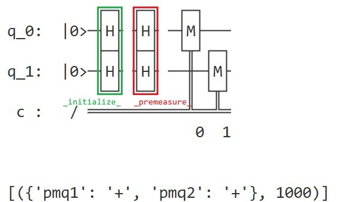
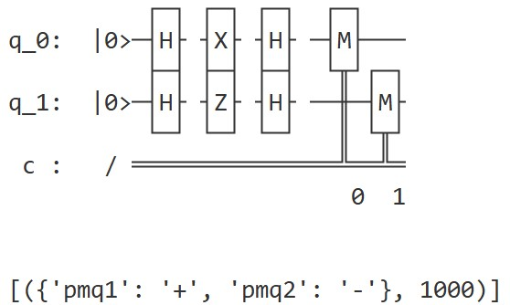
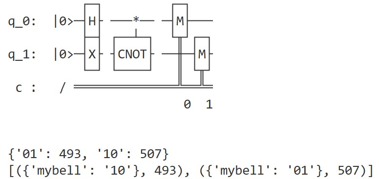
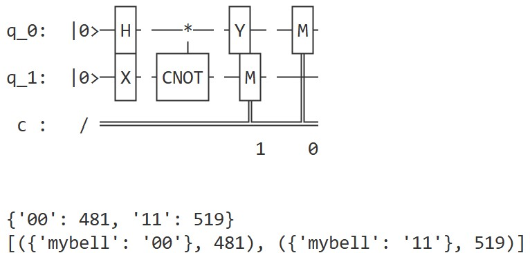

# Custom Quantum Data Types
PyQuantumKit's quantum data type system provides support for building quantum data types with complex structures.

In PyQuantumKit, the base type of all quantum data types is the abstract class `QVar`, so to build a custom quantum data type, you need to derive a subclass directly or indirectly from the `QVar` class. In most cases, users usually do not need to derive directly from the `QVar` class, but rather derive from its subclasses (for example the qubit `Qubit`, the struct `QStruct`, the qubit array `QubitArray`, etc.).

A data type usually binds data together with the methods that operate on the data. Python classes provide a mechanism for defining functions that belong to objects of the class (called "methods"); using this mechanism, PyQuantumKit allows users to add or override methods belonging to a custom quantum data type.

## 1. Inheritance and Composition

In classical program design, there are two ways to define custom data types: **inheritance** and **composition**. Based on Python's object-oriented type system, PyQuantumKit likewise supports defining custom quantum data types in both ways.

### Defining quantum data types by inheritance
The following example defines a `QuBool` type by inheriting from the `Qubit` class. It inherits all the functionality of the `Qubit` type, except that the output result interpretation is changed from generating `'0'`/`'1'` to generating `False`/`True`.
```python
class QuBool(Qubit):
    def _interpret_(self, output):
        return (True if super()._interpret_(output) == '1' else False)
```
Every quantum variable has the special method `_interpret_` (see below), which defines how the type interprets the result string. In the above example, the `QuBool` class overrides this method of its parent class `Qubit`: it first calls the parent class method, and if the parent class method returns `1`, it returns `True`; otherwise it returns `False`. The `_interpret_` method of the `Qubit` type already contains the logic of error-checking and error-reporting for illegal strings (strings that are not `'0'`/`'1'`), so the `_interpret_` of the `QuBool` type does not need to additionally handle illegal strings.

Similar to classical program design, **the inheritance approach expresses "is-a" semantics**, so the specific semantics expressed by this example is: *the `QuBool` type is a special kind of `Qubit` type.*

### Defining quantum data types by composition
The `pyquantumkit.program.quint` module defines the unsigned quantum integer `QuUnsignedInt` (`QuInt` is actually an alias of this type), and the rough framework of its definition is as follows:
```python
class QuUnsignedInt(QStruct):
    def __init__(self, length, varname = None):
        super().__init__(varname)
        self.__qubits = QubitArray(length)
        self.init_qstruct(self.__qubits)

    def _interpret(self, output : str):
        # ......
    def __len__(self):
        # ......
    def create_classical_value(self, number : int):
        # ......
    def create_two_value_superposition(self, x : int, y : int, phi : float = None):
        # ......
    
    # ......
```
That is, the `QuUnsignedInt` type is itself a struct, and the struct encapsulates a private field `self.__qubits` of the qubit array type (`QubitArray`). We wrote the method `_interpret_` for interpreting the result string, the magic method `__len__` for obtaining the length using `len()`, and also added methods such as `create_classical_value` for preparing the quantum state representing a classical integer and `create_two_value_superposition` for preparing a two-value superposition state.

The `QuUnsignedInt` type is not built by directly inheriting the `QubitArray` type, but by encapsulating a field of the `QubitArray` type inside the struct. This is because, if the inheritance approach were used, the `QuUnsignedInt` would inherit all the methods of the `QubitArray` type, such as the `create_state_by_01pm_str` method that operates per qubit. However, as a variable with "integer" semantics, we do not want users to call such low-level methods.

In most cases, custom quantum data types are built through composition. **The composition approach expresses "has-a" semantics**, so the semantics expressed by this example is: *a quantum integer has an array of qubits for storing information.* Based on this example, **we believe that the principle of "composition over inheritance" still applies to the construction of quantum data types.**

## 2. Special Methods
PyQuantumKit's quantum data types provide some special methods. These methods usually do not need to be called directly, but are called automatically when a particular operation (for example initialization, measurement, or interpretation of the result string) is performed. Every quantum variable has a default or explicitly defined special method.

In PyQuantumKit, it is agreed that the special methods of quantum types are named "starting with a single underscore and ending with a single underscore." Each special method is introduced below.

### Initialization operation `_initialize_`
When the `declare_qvars()` operation is performed on a quantum variable, the initialization operation `_initialize_` of the quantum variable is automatically called, and is usually used to prepare the initial quantum state for the quantum variable. The initialization operation is similar to a constructor in C++ or the `__init__` method of a Python class.

**Important note:** Since PyQuantumKit builds quantum data types based on Python syntax, when using it, **please carefully distinguish `__init__` from `_initialize_`: the former is the initialization as a Python class object, while the latter is the initialization of the quantum variable during the execution of the quantum program.**

When defining the `_initialize_` method, it only needs one parameter `self`, and does not need a return value:
```python
    def _initialize_(self) -> None:
        # specific code
```

If no explicit definition is given, the default initialization operation of the qubit `Qubit` is a no-op, and the default initialization operation of an array, struct, or union type variable is to call the corresponding initialization operation on each of its elements or fields.

The union needs a separate explanation here. Since the fields of a union share the qubits, the order of initialization is especially important. PyQuantumKit calls the initialization function of each field in order according to the order of the parameters passed when calling `init_qunion()`.

### Pre-measurement operation `_premeasure_`
When a measurement operation is performed on a quantum variable, PyQuantumKit automatically calls the pre-measurement operation `_premeasure_` of the quantum variable before applying the specific measurement gate. The pre-measurement operation is usually used to transform the measurement basis, to implement more general measurement operations (non-computational-basis measurements).

When defining the `_premeasure_` method, it only needs one parameter `self`, and does not need a return value:
```python
    def _premeasure_(self) -> None:
        # specific code
```

If no explicit definition is given, the default pre-measurement operation of the qubit `Qubit` is a no-op, the default pre-measurement operation of an array or struct type variable is to call the corresponding pre-measurement operation on each of its elements or fields, and a union type variable only calls the pre-measurement operation on the active field.

### Result string interpretation method `_interpret_`
The `_interpret_` method defines how a quantum variable of this type should interpret the `'0'`/`'1'` string of the measurement result.

When defining the `_interpret_` method, it needs two parameters: `self` and `output: str` representing the measurement result string; and its return value is the interpretation result.
```python
    def _interpret_(self, output : str) -> Any:
        # specific code
        # finally return the interpretation result
```

For a quantum data type defined through inheritance or composition, the interpretation of its result string can often be obtained by appropriately processing the result interpretation methods of the parent class or the contained fields. For example, in the previous `QuBool` type example, its `_interpret_` is obtained by appropriately processing the return result of calling `_interpret_` on its parent class `super()` (the `Qubit` type):
```python
class QuBool(Qubit):
    def _interpret_(self, output) -> bool:
        return (True if super()._interpret_(output) == '1' else False)
```

### Method for applying quantum gates to a data type `_gate_`
The `_gate_` method defines how to apply a quantum gate to a data type. Not all quantum variables have a `_gate_` method: the `Qubit` type has a `_gate_` method, but array, struct, and union type variables by default do not define a `_gate_` method. A quantum variable that defines a `_gate_` method can be treated as a qubit; for example, the `gate()` function of the `pyquantumkit.program.std` module can be used to apply a quantum gate to it.

When defining the `_gate_` method, it needs 4 parameters, the first being `self`, and the following three being the same as the parameters of the `gate()` function of the `pyquantumkit.program.std` module:
```python
    def _gate_(self, gate_name : str, qubit_var_list : list, paras : list) -> Qubit:
        # specific code
        # finally return the qubit that serves as the target of the applied quantum gate
```
The return value of the function is the qubit that needs to be the target of the applied quantum gate. If it is a custom type built by inheriting the `Qubit` type, after writing the preceding processing logic, you can usually directly return `self`.

The three parameters `gate_name`, `qubit_var_list`, and `paras` can also be replaced directly with `*args`. This shorthand can be used when these three parameters are not needed in the method, but the parameters cannot be omitted.
```python
    def _gate_(self, *args) -> Qubit:
        # specific code
        # finally return the qubit that serves as the target of the applied quantum gate
```


## 3. Examples of custom quantum data types
Below are several examples to illustrate how to use PyQuantumKit to define custom quantum data types.

#### **Example 1.** Define a qubit type `PMQubit` based on the $\ket{+},\ket{-}$ basis

First let's look at what functions the `PMQubit` type needs to implement. First, just as an ordinary qubit is usually initialized to the $\ket{0}$ state, a qubit based on the $\ket{+},\ket{-}$ basis also needs to take a state of one of the bases as its initial state. Here we assume that the state of a `PMQubit` type variable is initialized to $\ket{+}$ by default, which can be obtained by applying an H gate on the $\ket{0}$ state, so the initialization operation of this type should be an H gate.

Second, the measurement operation of the `PMQubit` type needs to be a measurement based on the $\ket{+},\ket{-}$ basis (rather than the usual computational basis $\ket{0}, \ket{1}$ measurement), so the required basis transformation needs to be defined using the pre-measurement operation. Since the $\ket{+},\ket{-}$ basis and the $\ket{0}, \ket{1}$ basis are related to each other through the H gate, the pre-measurement operation of this type is also an H gate.

Then, the measurement result of the `PMQubit` type should be expressed as `'+'`/`'-'` rather than `'0'`/`'1'`, which requires overriding the result string interpretation method. Since $\ket{+}$ and $\ket{0}$, and $\ket{-}$ and $\ket{1}$, are respectively related to each other through the H gate of the pre-measurement operation, the raw measurement result `'0'` corresponds to the final measurement result `'+'`, and `'1'` corresponds to `'-'`.

Finally, logically, `PMQubit` is a special kind of `Qubit`, which is is-a semantics, so it is suitable to define it using inheritance.

The definition implementation code is as follows:
```python
# A qubit type based on the |+>, |-> basis, defined by inheriting the Qubit class
class PMQubit(Qubit):
    # Initialization operation
    def _initialize_(self) -> None:
        gate('H', [self])

    # Pre-measurement operation
    def _premeasure_(self) -> None:
        gate('H', [self])

    # Interpret the measurement result
    def _interpret_(self, output : str) -> str:
        return ('+' if super()._interpret_(output) == '0' else '-')
```

In the above code, the `PMQubit` type inherits the `Qubit` type, but overrides the `_initialize_`, `_premeasure_`, and `_interpret_` methods. Since the `PMQubit` type itself is a `Qubit`, in the initialization operation and the pre-measurement operation, applying the H gate can directly use `self` as the target qubit.

Below we write a few programs to verify the behavior of the `PMQubit` type.

For the following program
```python
# Verify the initialization and pre-measurement operations of PMQubit
def qmain(builder : QProgramBuilder):
    pmq1 = PMQubit('pmq1')
    pmq2 = PMQubit('pmq2')
    builder.declare_qvars(pmq1, pmq2)
    builder.measure_all()
```
two `PMQubit` variables are declared and then measured directly. The compiled quantum circuit and running result are:

{ style="width: 60%; height: auto;" }

According to the definition, each `PMQubit` type quantum variable applies an H gate when declared, and also applies an H gate before measurement, so there are 4 H gates in total in the compiled quantum circuit (no optimization is performed in this example). The measurement result is interpreted as
```
[({'pmq1': '+', 'pmq2': '+'}, 1000)]
```
That is, logically, the default initial state of a `PMQubit` type variable is $\ket{+}$, which meets the requirement.

For the following program
```python
# Operations on PMQubit type variables
def qmain(builder : QProgramBuilder):
    pmq1 = PMQubit('pmq1')
    pmq2 = PMQubit('pmq2')
    builder.declare_qvars(pmq1, pmq2)

    gate('X', [pmq1])
    gate('Z', [pmq2])

    builder.measure_all()
```
based on the previous program, an X gate is applied to `pmq1`, and a Z gate is applied to `pmq2`, then measured. The compiled quantum circuit and running result are:

{ style="width: 60%; height: auto;" }

It can be seen that the generated quantum circuit inserts an X gate and a Z gate respectively between the pair of H gates of the initialization and the pre-measurement. The measurement result is interpreted as:
```
[({'pmq1': '+', 'pmq2': '-'}, 1000)]
```
After applying the X gate, the measurement result of `pmq1` is still `+`, while after applying the Z gate, the measurement result of `pmq2` becomes `-`, which is equivalent to a "bit flip." This is exactly opposite to the $\ket{0},\ket{1}$ basis, where the X gate flips the qubit while the Z gate only produces a phase transformation. In fact, according to the identities $X=HZH$ and $Z=HXH$, in the $\ket{+},\ket{-}$ basis, the roles of the Z gate and the X gate are exactly swapped.

#### **Example 2.** Define a qubit type `CliffordQubit` that only allows Clifford gates

First, `CliffordQubit` is also a special kind of `Qubit`, which is again is-a semantics, so it is defined using inheritance of the `Qubit` type.

Then the `CliffordQubit` type needs to check the kind of the quantum gate when applying a quantum gate, so the `_gate_` method needs to be overridden to add a step of checking the kind of the quantum gate.

The definition implementation code is as follows:
```python
# A qubit that only allows Clifford gates
class CliffordQubit(Qubit):
    def _gate_(self, gate_name : str, qubit_var_list : list, paras : list) -> Qubit:
        # Call the get_standard_gatename() function to convert gate_name to a PyQuantumKit standard name
        standard_name = get_standard_gatename(gate_name)

        # If the gate used is not a Clifford gate, report an error
        if standard_name not in {'I', 'X', 'Y', 'Z', 'S', 'H', 'CX', 'CY', 'CZ', 'SW', 'ISW'}:
            raise QuantumProgramBuildError(f"Cannot apply non-Clifford gate '{gate_name}' on the CliffordQubit '{self.get_varname()}'")
        
        # If the gate used is a Clifford gate, return self as the target of gate()
        return self
```
In the above code, the `CliffordQubit` type inherits the `Qubit` type, but overrides the `_gate_` method. Before returning `self` as the target qubit for applying the quantum gate, it first calls the `get_standard_gatename()` function (provided by PyQuantumKit) to convert the name of the quantum gate to a standard name, and then checks whether it is a Clifford gate based on the standard name. If not, an error is reported.

The above examples define special qubit types by overriding the special methods of the `Qubit` type. Below is an example of defining a quantum data type using composition.

#### **Example 3.** Define a data type that stores a Bell state, and provide transformation operations among the four Bell states

The definitions of the four Bell states are:

$$
\begin{aligned}
\ket{\Phi^+} &= \frac{\ket{00} + \ket{11}}{\sqrt{2}} \\
\ket{\Phi^-} &= \frac{\ket{00} - \ket{11}}{\sqrt{2}} \\
\ket{\Psi^+} &= \frac{\ket{01} + \ket{10}}{\sqrt{2}} \\
\ket{\Psi^-} &= \frac{\ket{01} - \ket{10}}{\sqrt{2}}
\end{aligned}
$$

These four Bell states can be converted into each other by applying a Pauli gate ($I$, $X$, $Y$, $Z$) to any one of the qubits, as shown in the following table:

|  | $\ket{\Phi^+}$ | $\ket{\Phi^-}$ | $\ket{\Psi^+}$ | $\ket{\Psi^-}$ |
|----------------|------------------|------------------|------------------|------------------|
| $\ket{\Phi^+}$ | $I$              | $Z$              | $X$              | $Y$   |
| $\ket{\Phi^-}$ | $Z$              | $I$              | $Y$   | $X$              |
| $\ket{\Psi^+}$ | $X$              | $Y$   | $I$              | $Z$              |
| $\ket{\Psi^-}$ | $Y$   | $X$              | $Z$              | $I$              |

Now let's define a `BellQubitPair` type, and we want this type to provide the following functions:

1. Use two qubits to store a Bell state;
2. When declaring a variable of this type, it is necessary to specify which of these four quantum states is the initial state, and prepare that initial state;
3. The subscript access operator `[]` can be used directly on a `BellQubitPair` type variable to obtain the qubits in it, with the subscript value limited to 0 or 1;
4. Provide four methods `i()`, `x()`, `y()`, `z()` to implement the transformations among the Bell states according to the above table;
5. The measurement result is interpreted as a `'0'`/`'1'` string of length 2: `'00'`, `'01'`, `'10'`, `'11'`.

Let's look at how to implement each function in turn.

**Implementing function 1** requires putting two qubit variables together, and there are three options:

- Option 1: directly inherit the `QubitArray` type;
- Option 2: encapsulate a `QubitArray` type variable of length 2 in the struct;
- Option 3: encapsulate two `Qubit` type variables in the struct.

Option 1 is directly rejected, because semantically, `BellQubitPair` is not an array of qubits, but holds two qubits, which is clearly has-a semantics. Options 2 and 3 are both acceptable in principle, but considering the convenience of implementing function 5 (the interpretation of `QubitArray` can be directly reused), we adopt Option 2.

**When implementing function 2**, since the special method `_initialize_` takes no other parameters, it is necessary to declare a (classical) member variable inside the struct to store the state to be initialized. In the `__init__` method, an additional parameter needs to be added to indicate the state to be initialized, and this parameter is saved as a member variable. In this way, `_initialize_` can apply the corresponding quantum gate operation to prepare the quantum state based on this member variable.

Here we use a string variable to indicate the state to be initialized, allowing one of the following four strings: `'phi+'`, `'phi-'`, `'psi+'`, `'psi-'` (case-insensitive). Therefore, the parameters of the `__init__` method should be written as:

```python
    # Add a custom parameter state_str
    def __init__(self, state_str : str, varname=None):
        super().__init__(varname)
        # ......
```

**Note:** PyQuantumKit agrees that the `varname` representing the variable name in the `__init__` method of a quantum variable type should be the last parameter, with a default value of `None`, so that when defining an anonymous variable, the `None` parameter can be directly omitted, which is more readable in situations where anonymous variables are needed, such as arrays and tuples. To follow this agreement, the additionally introduced parameter `state_str` is placed before `varname`.

**When implementing function 3**, the `__getitem__` method needs to be defined to check whether the subscript is valid (0 or 1) and return the corresponding qubit.

**When implementing function 4**, define four additional methods `i()`, `x()`, `y()`, `z()`.

**When implementing function 5**, the special method `_interpret_` needs to be overridden. Since we use the `QubitArray` type to store the two qubits, the `_interpret_` special method of the `QubitArray` type can be directly reused.

The following is the complete definition of the data type:

```python
# A type that stores a Bell state
class BellQubitPair(QStruct):
    # Add a string parameter state_str in the __init__ method to specify the initial Bell state
    #    The string should be one of 'phi+', 'phi-', 'psi+', 'psi-'
    def __init__(self, state_str : str, varname=None):
        super().__init__(varname)

        # Define a (classical) variable self.__state to store the initial state, for later use by the _initialize_ method
        self.__state = state_str.lower()
        # Check whether the passed string meets the requirement
        if self.__state not in {'phi+', 'phi-', 'psi+', 'psi-'}:
            # Illegal string; report an error
            raise QuantumProgramBuildError(\
                "The string about init state must be one of 'phi+', 'phi-', 'psi+', 'psi-'")

        # Define an array containing two qubits to store the quantum state
        self.__qubit_pair = QubitArray(2)
        self.init_qstruct(self.__qubit_pair)

    # Subscript access method
    def __getitem__(self, index : int):
        if index not in {0, 1}:
            raise QuantumProgramBuildError("The index must be 0 or 1.")
        # Return the result of subscript access to the qubit array self.__qubit_pair
        return self.__qubit_pair[index]

    # Initialization operation
    def _initialize_(self) -> None:
        super()._initialize_()
        # Decide which quantum state to prepare based on the value of self.__state
        if self.__state == 'phi+':
            pass
        elif self.__state == 'phi-':
            # Note: since we defined __getitem__, we can directly use self[index]
            gate('X', [self[0]])
        elif self.__state == 'psi+':
            gate('X', [self[1]])
        elif self.__gtate == 'psi-':
            gate('X', [self[0]])
            gate('X', [self[1]])
        gate('H', [self[0]])
        gate('CNOT', [self[0], self[1]])

    # Transformation operations i(), x(), y(), z()
    def i(self) -> None:
        pass
    def x(self) -> None:
        gate('X', [self[0]])
    def y(self) -> None:
        gate('Y', [self[0]])
    def z(self) -> None:
        gate('Z', [self[0]])

    # Interpret the measurement result
    def _interpret_(self, output) -> str:
        # Directly use the interpretation result of the qubit array self.__qubit_pair
        return self.__qubit_pair._interpret_(output)
```

Let's try using the `BellQubitPair` type below.

The following program `qmain1` declares a `BellQubitPair` variable whose initial state is $\ket{\Psi^+}$ (corresponding to the string `'psi+'`), and names it `'mybell'`:
```python
def qmain1(builder : QProgramBuilder):
    mybell = BellQubitPair('psi+', 'mybell')
    builder.declare_qvars(mybell)
    builder.measure_all()
```
Compile it into a QPanda3 quantum circuit, print the generated circuit, and view the interpretation of the running result:
```python
qpbuilder = QProgramBuilder()
qpbuilder.build(qmain1)

qpanda_cir = qpanda.QProg()
qpbuilder.get_built_circuit() >> qpanda_cir
print(qpanda_cir)

qpanda_qvm = qpanda.CPUQVM()
qpanda_qvm.run(qpanda_cir, 1000)
qpanda_result = qpanda_qvm.result().get_counts()
print(qpanda_result)

rec_result = qpbuilder.interpret_result_dict(qpanda_result, 'r')
print(rec_result)
```

{ style="width: 70%; height: auto;" }

Compared to `qmain1`, the following program `qmain2` calls the `y()` method of the `mybell` variable before measurement:
```python
def qmain2(builder : QProgramBuilder):
    mybell = BellQubitPair('psi+', 'mybell')
    builder.declare_qvars(mybell)
    mybell.y()
    builder.measure_all()
```
Its compilation and running result is:

{ style="width: 70%; height: auto;" }