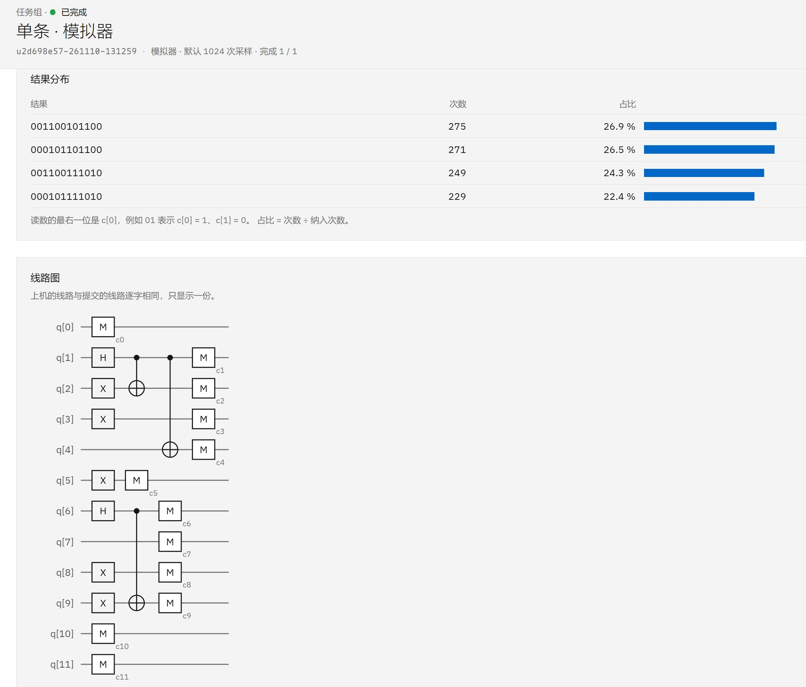

# 示例：在Quafu平台上运行高级语言级量子程序
本例演示如何利用PyQuantumKit在实际的量子开发平台上运行包含量子数据类型的高级语言级量子程序。

这里我们编写一个制备并测量量子态
$$
\frac{1}{\sqrt{2}}\left(\ket{a} + \ket{b}\right) \otimes \frac{1}{\sqrt{2}}\left(\ket{c} + \ket{d}\right)
$$
的量子程序，其中 $a,b,c,d$ 为预先给定的4个整数，整数的长度可调。将程序提交到北京量子院提供的**新版Quafu平台**（[https://quafu.com.cn/](https://quafu.com.cn/)）上的模拟器运行，并解读返回的结果。

## 1. 高级语言程序编写
为了表达上述量子态，我们需要准备两个量子整型变量`qnum1`和`qnum2`，然后在其上分别制备量子态 $\frac{1}{\sqrt{2}}\left(\ket{a} + \ket{b}\right)$ 和 $\frac{1}{\sqrt{2}}\left(\ket{c} + \ket{d}\right)$ 。可以利用PyQuantumKit提供的高级语言级量子编程功能来完成，代码编写如下：

```python
import quafu
from pyquantumkit import QProgramBuilder, update_language_translation
from pyquantumkit.program.std import *
from pyquantumkit.program.quint import *

# 输入的整数和长度
N = 6       # 每个整数占6位
a = 44
b = 58
c = 5
d = 12

# ---------- 主函数 ----------
def qmain(builder : QProgramBuilder):
    # 声明两个量子整型变量
    qnum1 = QuInt(N, 'qnum1')
    qnum2 = QuInt(N, 'qnum2')
    builder.declare_qvars(qnum1, qnum2)

    # 分别为两个量子整型变量制备二值叠加态
    qnum1.create_two_value_superposition(a, b)
    qnum2.create_two_value_superposition(c, d)

    # 测量
    builder.measure_all()
```

为了演示方便，这里我们用全局变量来直接给定输入。

## 2. 编译并导出为OpenQASM 2.0代码
新版Quafu平台采用OpenQASM 2.0代码格式来提交量子线路，而PyQuantumKit支持导出到OpenQASM 2.0代码。我们首先需要将高级语言级量子程序编译为量子线路，然后再导出为OpenQASM 2.0代码。

```python
# 将高级语言级量子程序编译为量子线路
builder = QProgramBuilder()
builder.build(qmain)

# 将量子线路转换为OpenQASM 2.0代码
code = builder.get_built_circuit().export_standalone_code('OpenQASM2.0', 'qs')
print(code)     # 打印导出的代码
```

这里调用了`QProgramBuilder`类对象的`get_built_circuit()`方法获得编译得到的`CircuitIO`类对象，再调用`CircuitIO`类对象的`export_standalone_code()`方法导出量子线路对应的OpenQASM 2.0代码。

打印导出的代码，得到的输出为：

```
// OpenQASM 2.0 code exported from PyQuantumKit
OPENQASM 2.0;
include "qelib1.inc";

qreg qs_q[12]; creg qs_c[12];
x qs_q[3];
x qs_q[5];
h qs_q[1];
x qs_q[2];
cx qs_q[1],qs_q[2];
cx qs_q[1],qs_q[4];
x qs_q[8];
h qs_q[6];
x qs_q[9];
cx qs_q[6],qs_q[9];
measure qs_q[0] -> qs_c[0]; 
measure qs_q[1] -> qs_c[1]; 
measure qs_q[2] -> qs_c[2]; 
measure qs_q[3] -> qs_c[3]; 
measure qs_q[4] -> qs_c[4]; 
measure qs_q[5] -> qs_c[5]; 
measure qs_q[6] -> qs_c[6]; 
measure qs_q[7] -> qs_c[7]; 
measure qs_q[8] -> qs_c[8]; 
measure qs_q[9] -> qs_c[9]; 
measure qs_q[10] -> qs_c[10]; 
measure qs_q[11] -> qs_c[11];
```

## 将OpenQASM 2.0代码提交到Quafu平台，运行并取得原始结果
这一步的具体代码编写可参考Quafu平台的用户手册，我们这里使用云平台提供的模拟器来运行（设置参数`target="sim"`），重复次数（shots）设置为1024。

```python
job = quafu.submit(code, target="sim", shots=1024)
print("任务组号：", job.id)

raw_counts = job.result().counts
print("原始结果：", raw_counts)
```

命令行输出：
```
任务组号： u2d698e57-261110-131259
原始结果： {'001100101100': 275, '000101111010': 229, '000101101100': 271, '001100111010': 249}
```

也可去Quafu网站查看更详细的运行信息：


## 解读原始结果
对于高级语言级量子程序，还需要从原始结果中恢复量子数据类型的信息。调用`interpret_result_dict`方法从原始结果字典解读量子数据类型信息。

**注意：新版Quafu平台的测量结果采用从右开始约定（`'r'`），这与旧版PyQuafu的约定正好相反。**

```python
# 解读原始测量结果
interpret_counts = builder.interpret_result_dict(raw_counts, 'r')
print("解读结果：", interpret_counts)
```

输出：

```
解读结果： [({'qnum1': 44, 'qnum2': 12}, 275),
({'qnum1': 58, 'qnum2': 5}, 229),
({'qnum1': 44, 'qnum2': 5}, 271),
({'qnum1': 58, 'qnum2': 12}, 249)]
```

测量结果的组合恰好是(44, 5)、(58, 5)、(44, 12)、(58, 12)四种，符合预期。
